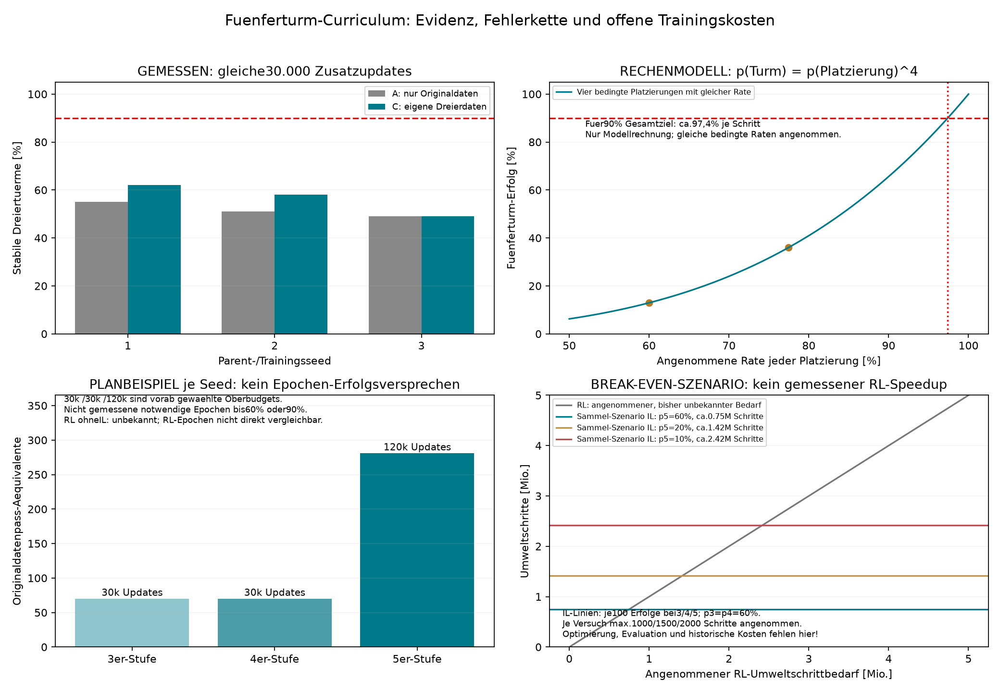

# Fuenferturm: Hypothese und Vorschlag vor Trainingsfreigabe

Status23.10.2026: Nur Analyse, Literaturpruefung und Grafik. **Kein neuer Trainingsprozess und keine Automation gestartet.** Ausfuehrung erst nach dem expliziten Go des Nutzers. Vorgesehene Gesamtgrenze maximal12h ab Freigabe/Sessionstart, Agentkontrolle ausschliesslich stuendlich; automatische technische Deadlineaufsicht ist davon getrennt.

## Entscheidung nach Diskussion mit zwei Agenten

Agent1 argumentiert fuer ein Curriculum3→4→5: erfolgreiche eigene Episoden liefern die Zustaende der naechsten Hoehe, und eine Zwischenstufe muss nicht zuerst90% erreichen, bevor brauchbare neue Daten entstehen. Bei60% kompletter Erfolgsrate braucht man im Rechenmodell im Mittel100/0,6≈167 Versuche fuer100 Erfolge. Das ist eine ungekappte Erwartungsrechnung; im echten Versuch bleiben feste Versuchsobergrenzen verbindlich.

Agent2 warnt: Die untere Turmgeometrie ist bereits bei drei Wuerfeln der Engpass.60% sind keine hinreichende Teilfertigkeitszuverlaessigkeit. Das Modell sieht Hindernisse und den restlichen Turm nicht explizit. Erfolgsauswahl kann leichte Starts konservieren, und bei identischer deterministischer Selbstkopie gibt es zunaechst keinen Actorgradienten. Laengeres Training beseitigt diese Informations- und Abdeckungsgrenzen nicht automatisch.

**Synthese:**60% vollstaendiger Erfolg sind ein Sammel-/Aufstiegsgate, kein Abschluss der Stufe. Fruehere Hoehen weitertrainieren und testen. Nicht alles Budget auf den Fuenfer legen, wenn seine Voraussetzungen oder erfolgreichen Beispiele fehlen. Ein Pilot darf mit einer diagnostizierten Vierer-Blockade enden statt unbemerkt unbrauchbare Fuenferdaten zu erzeugen.

Lokale Evidenz: Der letzte budgetgleiche Pilot mit30.000 Zusatzupdates pro Arm/Parent erzielte A(nurOriginal)55/51/49%, B(zusaetzlicheZweier)56/50/47%, C(zusaetzlicheDreier)62/58/49%. C hat gegenA+7,+7,0Prozentpunkte. Zwischenstufen automatisches60%-Gate fuer ALLE drei Parents ist aktuell nicht bestaetigt. Der beste einzelne Dreierteacher erreicht etwa60%, das Teacherpoolmittel nicht. Keine nachtraegliche Umdeutung eines auf Testdaten ausgesuchten Teachers zu einem unabhaengigen Test.

## Was die Zuverlaessigkeitsrechnung bedeutet

Ein Fuenferturm benoetigt vier erfolgreiche Platzierungen. Nach der Kettenregel ist sein Erfolg das Produkt ihrer bedingten Erfolgsraten. Fuer die Grafik werden diese vier Raten vereinfachend gleich gesetzt; das ist keine empirische Annahme ihrer tatsaechlichen Gleichheit. Bei60% je Platzierung bleiben0,6^4=12,96%. Bei60% fuer den kompletten Dreierturm und hypothetisch gleich guten Platzierungen p=sqrt(0,6) waeren Fuenfertuerme nur36% erfolgreich. Beruecksichtigt man stattdessen98% erste Platzierung und60% Dreierturm und setzt die spaeteren bedingten Raten jeweilsgleich60/98, ergibt sich ungefaehr22,5% fuer den Fuenfer. Das sind verschiedene Annahmenmodelle, keine widerspruechlichen Vorhersagen.

Fuer90% Fuenferturm-Erfolg braucht das gleiche-Raten-Modell p=0,9^(1/4)≈97,4% je Platzierung. Mit60% Zwischenleistung koennen wir Daten erzeugen, aber nicht bereits die Endzuverlaessigkeit garantieren. Abhaengigkeiten durch Hoehe, Turmzustand und Fehlerhistorie muessen tatsaechlich gemessen werden.

## Testbare Hypothese

H1: Bei gleicher Architektur, denselben drei Ausgangsmodellen und gleichem gesamten zusaetzlichen Update-/Simulatorbudget erreicht ein Curriculum mit erfolgreichen eigenen3-/4-/5er-Rollouts eine hoehere vollstaendige Fuenfer-Erfolgsrate als direktes Weitertraining auf Fuenfer-Rollouts ohne Zwischenstufen. Original- und fruehere Hoehendaten bleiben in beiden verfuegbaren Quellen protokolliert. Ist der direkte Fuenferpfad mangels Erfolgen blockiert, ist das ein Datenverfuegbarkeitsbefund, kein erfundener numerischer Lernerfolg.

H2: Nach Erreichen des60%-Sammelgates ist zusaetzliches langes Training ausschliesslich auf der Fuenferstufe effizienter als zusaetzliche Zeit auf Zwischenstufen nur dann, wenn Uebergang/Erhalt des unteren Turms beim Fuenfer bereits hinreichend funktionieren. Das wird aus phasenweisen Fehlern und Lernkurven geprueft, nicht vorausgesetzt.

Erfolgskriterium des Piloten ist zunaechst ein positiver gepaarter Fuenferunterschied mit ausgewiesener Streuung; das ambitionierte90%-Punktziel bedeutet weiterhin mindestens90/100 pro JEDEM der drei Trainingsseeds. Nicht erreicht bedeutet nicht bestaetigt. Drei Seeds sind fuer weitreichende statistische Ueberlegenheit knapp.

## Epochen und die gewuenschte Vergleichsgrafik

Fuer **ohne IL** wird hier vorlaeufig RL aus zufaelliger Initialisierung angenommen. Es existiert lokal kein entsprechender5er-Lauf und keine kalibrierte RL-Pipeline. Eine konkrete erwartete Zahl bis zum60%- oder90%-Ziel waere erfunden. Die Grafik weist RL deshalb als ungemessen aus. RL-Epochen(z.B.PPO-Paesse ueber gesammelte Rollouts) sind nicht dasselbe wie BC-Datenpaesse; ein direkter Quotient waere irrefuehrend.

Die Balken untenlinks sind ausschliesslich ein **zusaetzliches BC-Planbudget pro Seed**:30k Updates fuer die3erStufe,30k fuer4er,120k fuer5er; Batch64. Bezogen auf die unveraenderten27.322 Originalframes ergibt das70,3/70,3/281,1 Originaldatenpass-Aequivalente, insgesamt421,6. Diese Normierung bleibt konstant, obwohl der gemischte Datensatz waechst. Es sind keine klassischen Epochen und keine erwarteten notwendigen Trainingsmengen. Historische Vortrainingskosten von unter anderem327k Updates fuer einen Teacher kommen bei einer Gesamtkostenrechnung hinzu.

Untenrechts wird ein Sammel-Kostenszenario gezeigt:100 akzeptierte Episoden pro Hoehe, p3=p4=60%, p5 hypothetisch60/20/10%, maximale Schritte pro Versuch1000/1500/2000. Daraus folgen als obere Pro-Versuch-Kostenannahme ca.0,75/1,42/2,42Mio neue Sammelschritte. Auswertung, Optimierung und historische Kosten fehlen absichtlich in diesem Teilbild und muessen zur Gesamtbilanz addiert werden. Die RL-Diagonale parametrisiert einen unbekannten Bedarf, sie ist keine gemessene Lernkurve. Ein IL-Vorteil waere erst nach Messung der vollstaendigen Kosten nachgewiesen.

Primaere Effizienzmasse fuer einen echten Methodenvergleich: gesamte Simulatorinteraktionen, reale Zeit und Hardware; zusaetzlich Optimizerupdates, verarbeitete Beispiele und Enderfolg. Gemeinsamer Endtask und Erfolgskriterium, feste Evalbudgets. Vortrainingskosten und neue Sammlung nicht als kostenlos behandeln. Ein Vergleich ab jetzigen Parentgewichten misst nur marginale Fortsetzungskosten.

## Technische Voraussetzungen vor dem ersten Training nach Go

StackFour._load_model zippt derzeitABCD mit vier Farben. cube_count=5 allein erzeugt weiterhin nurvier Objekte. Dazu waehlt make_env bei count!=2 die Dreierumgebung; der bestehende Collector schaltet nur einmal zum zweiten Paar. Diese Komponenten muessen auf echte2–5Objekte, beliebig viele Paarwechsel und Rueckzuege erweitert werden.

Erfolg ueber alle N−1 benachbarten Kontakte, Tischbasis, Geometrie, niedrige Geschwindigkeiten und fehlenden Greiferkontakt pruefen;50 durchgehendeFrames inklusive2s Nachstabilitaet. Gezielte positive und negative Physiktests, sichtbare/verifizierte fuenfte Objekt-ID sowie keine stillen Reset-/Teleport-Hilfen im Haupttest. Vorbereitete Tuerme nur Diagnose und nicht als vollstaendige5erErfolge zaehlen. Horizont N-abhaengig vorab festlegen (500 Schritte je benoetigter Platzierung als Startvorschlag).

Die jetzigen10Inputs enthalten nur EEF-Ankerabstand, Orientierung, Finger und Zeit. Eine Turm-/Freiraumdarstellung ist eine moegliche notwendige Verbesserung; ihre Einfuehrung waere ein zusaetzlicher Methodenfaktor. Fuer den ersten Curriculumvergleich Architektur gleich lassen, fehlende Beobachtbarkeit als moeglichen Blocker diagnostizieren. Falls der Blocker eintritt, nicht still mitten im Vergleich Architektur wechseln, sondern neuen Arm und Initialisierung dokumentieren.

## Vorgeschlagener12h-Lauf nach Go

| Zeitbudget | Arbeit und Entscheidung |
|---|---|
|0–1h|Echte5erUmgebung/Collector und Mehrfach-Paarwechsel implementieren, physikalisch und zeitlich validieren, Seeds/Hashes einfrieren; noch keine Erfolgsgarantie|
|1–3h|3erStarts auf neuer Entwicklung pruefen, erfolgreiche eigene Daten sammeln, maximal begrenzte Aktualisierung; kleiner4er/5erProbeversuch ohne Optimierungslabels|
|3–5h|Wenn Gate/Datenabdeckung passen:4erSammlung und begrenzte Anpassung, 2/3Regression pruefen; ansonsten gezielte Blockadendiagnose|
|5–10h|Verbleibendes Budget fuer5erCurriculum-/Direktvergleich und Lernkurven; nur bei vorhandenen brauchbaren Daten; Zwischenstufen im Replay behalten|
|10–12h|Gewichte nach Entwicklung einfrieren; getrennte Endtests und Fehleranalyse, Kosten-/Epochenbilanz und Bericht; kein Training nach Deadline|

Die Zeiten sind Oberbudgets, kein Skript, das nach Uhrzeit ungeachtet der Gates die Hoehe erhoeht. Auswahl/Sammlung/Bewertung zaehlen in12h. Direkter5erIL-Vergleich als Kontrollarm ist im Hauptpilot sinnvoller als ein neu zu entwickelnder kompletter RL-Stack. Ein echter RL-ohneIL-Vergleich sollte als eigener kalibrierter Lauf geplant werden; im12hPilot wird kein vollwertiger RL-Benchmark vorgetaeuscht. Wenn der Nutzer RL zwingend in denselben12h vergleichen moechte, muss das Budget entsprechend zwischen implementiertem RL und Curriculum aufgeteilt werden; dann ist nur eine Machbarkeitskalibrierung zu erwarten.

Je Parent separate Lernkurven.60%-Gate: mindestens30/50 komplette stabile Tuerme auf vorab festgelegter neuer Entwicklung, im zweiten disjunkten50erBlock bestaetigen bevor daraus eine robuste Aufstiegsentscheidung behauptet wird. Die Schwelle ist ein praktisches Gate, kein Konfidenzbeweis. Ein einzelner Teacher kann zur Datenproduktion dienen, aber nicht einen gescheiterten Seed als bestanden ersetzen. Drei Lernreplikate duerfen denselben eingefrorenen Teacherpool nutzen; Herkunft/Splits bleiben sichtbar.

Pro Hoehe maximalzwei begrenzte Sammel-/Updatezyklen, feste Versuchscaps vor Erfolgsauswahl. Weniger als20 erfolgreiche vollstaendige Episoden einer neuen Hoehe im festgelegten Probe-/Sammelbudget: nicht blind zum naechsten Training springen. Original-/fruehere Hoehendaten mindestens50% der Replaymasse erhalten als konservativer Startwert; neue Hoehe maximal50%, nach Phase/Episode balanciert. Mischungsverhaeltnis vor Armstart fixieren. Keine Abschluss-Pseudolabels als neue Expertenwahrheit. Auswahl nur auf Entwicklung, neue Endtestbereiche vorab registrieren, keine alten125000er/126000er Tests wieder zur Auswahl verwenden.

Agentmonitoring nur1×pro Stunde, mit Logeintrag und Meldung nur bei wesentlichem Fortschritt/Fehler/Abschluss. Unabhaengiger technischer Supervisor setzt harte12hDeadline und verhindert automatischen Schlaf; seine Prozessaufsicht ist keine dauernde Agentenanalyse. Bei wissenschaftlicher Stagnation geplante Diagnose statt unlimitierter neuer Versuche. Bei technischem Fehler kontrollierte Reparatur mit erhaltenen Artefakten innerhalb derselbenDeadline. Keine Automation vorGo eingerichtet.

## Literatur und Grenzen der Uebertragung

[Li et al., Relational RL, ICRA2020](https://richardrl.github.io/relational-rl/) verbindet Blockzahl-Curriculum mit einer relationalen Architektur. Das unterstuetzt die Plausibilitaet des Ansatzes, beweist aber weder Erfolg unseres aktuellen Inputs noch reine BC-Skalierung.

[Florensa et al., Reverse Curriculum, CoRL2017](https://proceedings.mlr.press/v78/florensa17a.html) untersucht ein anderes Curriculum ueber Startzustaende in RL. Es belegt keine passende60%-Schwelle fuer unsere Aufgaben.

[Oh et al., Self-Imitation Learning, ICML2018](https://proceedings.mlr.press/v80/oh18b.html) ist ein Actor-Critic-Verfahren mit guten eigenen Erfahrungen. Unsere erfolgsgefilterte BC-/Teacherpool-Destillation ist kein identischer Algorithmus.

**Freigabestand:** Der Nutzer erhaelt diese Ueberlegungen und Grafik vor dem Go. Keine neue Sammlung, kein Training und keine stündliche Wiedervorlage gestartet.
