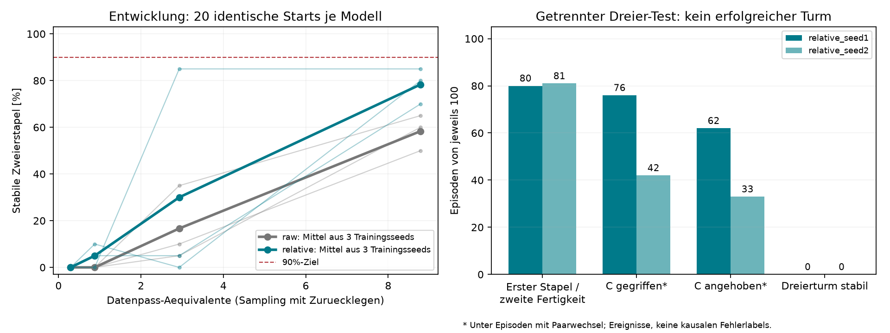

# Auswertung vom 23.10.2026

**Das Ziel ist nicht erreicht.** Die relative Darstellung verbessert den beobachteten Zweier-Erfolg, aber keiner der ausgewerteten Versuche erzeugte einen stabilen Dreierturm.

Der begrenzte Pilot wurde technisch erfolgreich nach 38.81 Minuten beendet (00:32 bis ca. 01:10:53 Uhr Europe/Berlin). Acht Stunden waren eine Obergrenze; der feste Versuchsplan war vorher abgearbeitet. Es fand keine achtstuendige iterative Methodensuche statt. Sechs Modelle wurden je 30.000 Updates trainiert, insgesamt 180.000 Updates. Training inklusive Checkpoints beanspruchte laut Instrumentierung 5.76 Minuten; der Rest der Gesamtzeit entfiel ueberwiegend auf Simulation, daneben Datenladen und Prozessaufwand.

## Zweier-Erfolg bei 30.000 Updates

Entwicklungsdaten: je 20 identische Starts, keine unabhaengigen abschliessenden Zweier-Tests.

| Darstellung | Seed 1 | Seed 2 | Seed 3 | Mittel |
|---|---:|---:|---:|---:|
| Absolut (raw) | 50% | 60% | 65% | 58,3% |
| Relativ | 80% | 85% | 70% | 78,3% |

Gepaarte Unterschiede: +30, +25, +5 Prozentpunkte, Mittel +20. Alle drei Seeds zeigen dieselbe Richtung. Das ist ein positives Entwicklungssignal, kein breiter statistischer Ueberlegenheitsnachweis. Die historische grosse Direct-Baseline ist wegen anderer Architektur, Skalierung, EMA und Erfolgskriterien nicht direkt vergleichbar.

## Dreier-Test und Uebergang

| Modell | Ausgewaehlte Updates | Erste Paarplatzierung / 100 | C gegriffen* | C angehoben* | Stabiler Dreierturm |
|---|---:|---:|---:|---:|---:|
| relative_seed1 | 30000 | 80 | 76 | 62 | 0/100 |
| relative_seed2 | 10000 | 81 | 42 | 33 | 0/100 |

* Greif-/Lift-Ereignisse innerhalb der Episoden, die zur zweiten Fertigkeit wechselten. Die gespeicherten Flags sind episodische Ereignisse; sie zeigen keine detaillierte zeitliche Abfolge oder eindeutige Fehlerursache. Lift bedeutet C-z > 0,88 m.

Pro getesteter Policy: Wilson-95%-Intervall fuer 0/100 etwa [0%, 3,7%]. Die beiden Modelle verwenden dieselben 100 Szenen, deshalb nicht als 200 unabhaengige Trainingsreplikate interpretieren. Fuer relative Seed 3 und alle raw-Seeds wurde das vorab definierte 80%-Zweiergate verfehlt; daher keine 100er-Testserie. Ihre kleinen abschliessenden Dreierdiagnosen waren ebenfalls ohne Erfolg. Fehlende Haupttests sind nicht mit gemessenen 0/100 gleichzusetzen.

Bei relative Seed 2 waren alle Dreier-Entwicklungsraten null. Die festgelegte Gleichstandsregel waehlte deshalb den frueheren Checkpoint bei 10.000 Updates, obwohl die spaetere 30.000er-Policy im Entwicklungstest C oefter griff (15/20 statt 8/20). Diese Regel war reproduzierbar, aber bei durchgehend null Enderfolg wenig aussagekraeftig fuer Teilfortschritte. Keine nachtraegliche Neuauswahl anhand der Testdaten.

## Was wir ueber Lerneffizienz sagen koennen

30.000 Updates mit Batch 8 entsprechen 8,784 Datenpass-Aequivalenten. Relative Seed 2 erreicht bereits bei 10.000 Updates (2,928 Aequivalente) 85% Zweier-Erfolg; die anderen Seeds erreichen am Ende 80% und 70%. Kein Seed erreicht die 90%-Zweierschwelle, kein Modell die Dreierschwelle. Eine Einsparung von Epochen bis zu 90% Dreier-Erfolg ist deshalb nicht nachgewiesen. Der sinkende Validierungsloss allein waere eine irrefuehrende Erfolgsmeldung.

## Fehlerinterpretation und naechster sinnvoller Versuch

Die Modelle erreichen den Paarwechsel in 80 beziehungsweise 81 der 100 Dreierszenen. Die Fehler liegen somit nicht ausschliesslich vor dem ersten Stapel. Viele Episoden zeigen auch Greifen/Anheben des dritten Wuerfels. Ob danach die Hoehenextrapolation, der Transport, das Absenken, Loslassen, eine Kollision oder der Zerfall des unteren Stapels entscheidend ist, laesst sich aus den vorhandenen Endmetriken nicht kausal entscheiden. Es wurden keine vollstaendigen Rollout-Zeitreihen oder Videos dieses Nachtlaufs gespeichert.

Prioritaet fuer eine Fortsetzung: feste Entwicklungsstarts mit den vorhandenen Checkpoints erneut abspielen und Positionen, Aktionen, Kontakte sowie Greiferstatus pro Schritt protokollieren. Dann den kontinuierlichen B→A→C-Ablauf gegen einen separat initialisierten Test der zweiten Platzierung auf einem vorgebauten Zweierstapel diagnostisch vergleichen. Der vorgebaute Stapel zaehlt niemals als vollstaendiger Taskerfolg und liefert keine Trainingslabels. Damit kann man Uebergangsprobleme und Hoehen-/Platzierungsprobleme besser trennen, bevor eine gezielte Architektur- oder Datenrepraesentationsaenderung getestet wird. Ein Training mit laengerer Historie ist eine pruefbare Hypothese fuer den Uebergang, keine belegte Loesung.

Weiterhin nur Zwei-Wuerfel-Demos fuer Training verwenden. Neue Recovery- oder erhoehte Zieldemos waeren ein veraendertes Datenprotokoll und muessen separat ausgewiesen werden. Nicht einfach das Updatebudget erhoehen und daraus eine Generalisierungsloesung erwarten. Die bereits angesehenen 100 Teststarts gelten fuer spaetere Methodenentwicklung als verbraucht; fuer einen neuen Endnachweis neue, vorab fixierte Starts verwenden.

## Nachpruefung

- 760 abgeschlossene Evaluationsrollouts aus den gespeicherten JSON-Dateien nachgezaehlt, Erfolgszaehler mit Einzelzeilen abgeglichen.
- Initialzustand-Hashes bei gleichen Aufgaben und Seeds ueber alle Modelle/Checkpoints identisch.
- Alle sechs Lernkurven enthalten die vier vorgesehenen Checkpoints bis 30.000 Updates.
- Auswertung fuehrt kein neues Training und keine Test-basierte Modellwahl durch.
- Detailzahlen: [analysis.json](analysis.json); urspruengliche automatische Tabelle: [RESULTS.md](RESULTS.md).