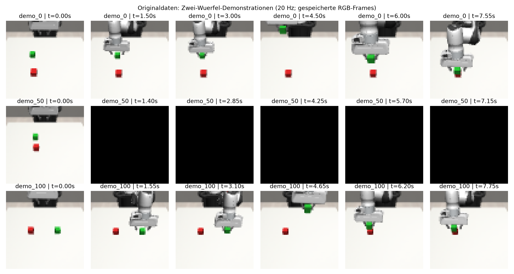
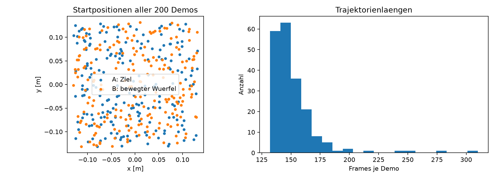

# Zwei-Wuerfel-Daten → Drei-Wuerfel-Turm

Stand: 23.10.2026. Neuer, auf maximal acht Stunden begrenzter Pilot. **90% sind das Ziel, kein bereits erzieltes Ergebnis.** Autorisierung: vorhandene Zwei-Wuerfel-Demos, lokale GPU, maximal acht Stunden. Keine Drei-/Vier-Wuerfel-Demos im Training, keine RL-Updates, keine Expertenlabels aus Testrollouts.

**Verifizierter Start:** 23.10.2026 um 00:32:03 Uhr Europe/Berlin; Deadline 08:32:03 Uhr. Hintergrundstart ausserhalb der Sandbox ueber `Start-Process -WindowStyle Hidden`, siehe `host_launch.json`; aktive Supervisor-/Worker-IDs in `status.json`. Der vorherige direkte Detached-Start aus der Sandbox blieb ohne aktiven Worker; dessen `launch.json` ist nur der erste Startversuch. Erste 1.000 echte Trainingsupdates und laufende Entwicklungsrollouts wurden beobachtet. Aktuelle Resultate stehen in den Statusdateien, diese Startnotiz ist kein Live-Status.

## Datensatz zuerst

| Eigenschaft | Vollstaendig gepruefter Stand |
|---|---|
| Datei | `experiments/baselines/additional_tasks/stack_two/data/image_demonstrations.hdf5` |
| Herkunft | Programmierter `StackExpert`, erfolgreiche Simulationstrajektorien; keine menschlichen PH-Demos |
| Aufgabe | Panda, zwei gleich grosse Wuerfel mit 4 cm Kantenlaenge, B auf A |
| Umfang | 200 Demos, 30.296 Zeitschritte, 71.004.521 Bytes |
| Split | 180 Training / 20 Validierung, disjunkte ganze Trajektorien, unveraenderte Masken |
| Frames | 27.322 Training / 2.974 Validierung |
| Laengen | Minimum 132, Median 147, Maximum 310 Frames; bei 20 Hz 6,60 / 7,35 / 15,50 Sekunden |
| Zustand | A- und B-Positionen (6), EEF-Position (3), EEF-Quaternion (4), Greiferpositionen (2): 15 Werte |
| Bilder | RGB 64×64, externe agentview-Kamera; hier nur zur Dokumentation |
| Aktionen | 7 Werte: XYZ, drei Rotationseingaenge, Greifer; normiert auf [-1,1]; Rotationslabels durchgehend null |
| Controller | OSC_POSE, world frame, relative Steuerung; max. Translation 0,05 m pro Aktionsskala, 20 Hz |
| SHA-256 | `5222cbf96dc6218389d491fe7b99449295dcfc9bceb3bab8f8776ffff19fe6f8` |

[Maschinenlesbarer Audit samt exakten Demo-IDs](dataset_audit.json). Alle verwendeten Zustands-/Aktionsarrays auf Form, Laenge und endliche Werte geprueft; saemtliche RGB-Frames auf vollstaendiges Schwarz geprueft. Keine vollstaendige physikalische Replay-Validierung aller Demos.

**Bildproblem:** 63 Demos enthalten insgesamt 6.995 vollstaendig schwarze Frames. Das ist die aktuelle, exakt definierte Zaehlung und weicht von der historischen Angabe 62 ab. Der Audit behauptet keine Ursache. Diese Demos bleiben im Zustandstraining; RGB wird nicht eingelesen. Eine Nutzung als Bild-Trainingsdatensatz braucht vorher eine eigene Reparatur-/Validierungsstrategie.

**Abdeckung und Grenzen:** Aufnahme endet beim nativen Erfolg nach 0,5 s stabiler Platzierung. Ein vollstaendiger Rueckzug ist daher nicht verlaesslich enthalten. Ziel A steht auf dem Tisch; Platzieren auf einem bereits hoeheren Turm und Wiederaufnahme einer weiteren Teilaufgabe sind nicht demonstriert. Alle aufgenommenen Demos sind erfolgreiche Expertentrajektorien; Fehler-/Recovery-Verhalten ist nicht systematisch vertreten. Die 200 Demos sind keine 200 unterschiedlichen Aufgaben.

## Hypothese und konkrete Trainingswahl

Hypothese: Eine paarbezogene relative Darstellung verbessert die Wiederverwendung derselben gelernten Stapelbewegung auf einem hoeheren Ziel. Das ist experimentell offen. Gemeinsame Translation von EEF und Objekten laesst relative Features unveraendert; ein hoeherer Zielwuerfel bei unveraenderter Ausgangshoehe des bewegten Wuerfels ist trotzdem eine neue Relation. Relative Koordinaten beseitigen diese Extrapolationsfrage nicht vollstaendig.

Kontrollierter Vergleich:

- **raw:** [A, B, EEF] nach Abzug des festen Tischursprungs [0,0,0,8] und Skalierung durch 0,1 m; Quaternion unveraendert, Greifer / 0,04 m.
- **relative:** [A−EEF, B−EEF, A−B] / 0,1 m; gleiche Quaternion und Greiferskalierung. Keine absolute Position. Beide Varianten haben 15 Merkmale je Frame.
- Gleiche Architektur: drei Residualbloecke, Breite 512, 1.652.336 Parameter, zwei Frames Historie, 16×7 Aktionsausgaben, Tanh. Keine EMA, keine neue Datenerhebung, keine Augmentation, keine Phasenlabels.
- Seeds 1, 2, 3; beide Arme frisch initialisiert. Gleiche Zufallsfenster pro Trainingsseed, Batch 8, MSE, AdamW 1e-4, Weight Decay 1e-6, 500 Updates Warmup und Cosine bis 30.000. Rotations- und Greiferlabels bleiben unveraendert.
- Chunk am Anker t: t−1 bis t+14; ausgefuehrt werden t und t+1. Padding am Rand wiederholt Randwerte. Nach Paarwechsel werden Historie und Aktionsqueue verworfen.

Historischer Kontext: Der grosse Direct-Regressor erzielte 70 / 75 / 77,5% bei zwei Wuerfeln, mit 67,5 Mio. Parametern und 30.000 Updates. Der neue kleine Kontrollarm ist **keine exakte Replikation**: Architektur, Skalierung und EMA unterscheiden sich vom historischen Lauf. Nur raw gegen relative ist hier ein isolierter Darstellungsvergleich. Das strengere Erfolgskriterium unten verhindert zudem einen direkten historischen Scorevergleich.

Ein kleineres Modell reduziert Rechenaufwand je Update; daraus folgt nicht automatisch weniger erforderliche Datenpaesse. Die Hypothese zur Lerneffizienz wird ueber Lernkurven geprueft, nicht durch eine andere Benennung von Epochen.

## Komposition und Grenze der Aussage

Die Umgebung `StackThree` verwendet dieselbe Geometrie/Physik wie das vorhandene StackFour, mit drei Objekten. Alle drei Wuerfel starten frei auf dem Tisch. Es werden keine Zwischenzustaende fuer die Hauptmetrik vorgegeben und keine Wuerfel teleportiert.

Ein **programmierter Aufgabenkoordinator** gibt zunaechst das Paar (A als Ziel, B als bewegter Wuerfel), nach zehn gueltigen stabilen Frames das Paar (B als Ziel, C als bewegter Wuerfel) vor. Die Policy erzeugt alle Roboteraktionen, auch beim Uebergang. Es gibt keinen Expert-Fallback und keine nachtraegliche Aktionskorrektur. Objektpositionen, Kontakte und Geschwindigkeiten aus der Simulation sind privilegierte Zustandsinformationen.

Ein Erfolg wuerde zeigen: **Mit reinem BC auf Zwei-Wuerfel-Demos gelernte Bewegung kann mit vorgegebener Paarreihenfolge zu einem Dreierturm zusammengesetzt werden.** Er wuerde nicht zeigen, dass das Modell selbst die Reihenfolge oder eine beliebige Anzahl Wuerfel gelernt hat. Ein rein autonomer Planer ist eine weitere Forschungsfrage. Vier Wuerfel bleiben ausserhalb dieses Piloten.

## Wann Simulation sinnvoll ist

1. Sofort ein technischer Kurztest auf zwei und drei Wuerfeln, noch ohne Leistungsinterpretation. Er prueft Shapes, Umgebung, Kontakte, Umschaltlogik und Endbedingungen. Zusaetzliche programmierte Expertenrollouts pruefen nur die Messbarkeit erfolgreicher Tuerme; sie erzeugen keine Trainingsdaten.
2. Nach 1.000, 3.000, 10.000 und 30.000 Updates jeweils 20 Zwei-Wuerfel-Entwicklungsstarts 61000–61019. Niedrige Offline-MSE allein ist kein Freigabekriterium.
3. Sobald wenigstens 16/20 Zweierstapel stabil sind: 20 Dreier-Entwicklungsstarts am selben Checkpoint. Das ist ein kostenguenstiges Diagnosegate, kein statistischer Nachweis ausreichender Zweierkompetenz.
4. Falls das Gate bis zum letzten Checkpoint nie erreicht wird: trotzdem fuenf Dreier-Diagnosestarts. Fehlende Haupttests klar als nicht evaluiert kennzeichnen.
5. Pro Arm/Trainingsseed Auswahl des Checkpoints mit hoechster Dreier-Dev-Rate unter den Checkpoints mit erfuelltem Zweiergate; bei Gleichstand frueheren behalten. Dann einmalig 100 neue Dreier-Teststarts 72000–72099. Testresultate veraendern weder Training noch Auswahl.

Das Gate spart Simulationen an sehr schwachen Policies. Fuer das Endziel braucht die zweite Teilfertigkeit trotz hoeherem Ziel und anspruchsvollerem Uebergang hohe Zuverlaessigkeit: Wenn beide notwendigen Stufen hypothetisch je 95% bedingten Erfolg erreichen, ergibt deren Produkt etwa 90,25%. Das ist eine Zielorientierung, keine Annahme unabhaengiger Fehler oder Prognose.

## Erfolg und Benchmark

Hauptmetrik: kompletter geordneter A/B/C-Turm aus einer Tischszene innerhalb 1.000 Steuerschritten (50 s Simulationszeit). Zweiertest: 500 Schritte. Der letzte Wuerfel muss bis zum Horizont einschliesslich Stabilitaetsphase fertig werden.

- Unterster Wuerfel auf Tischhoehe ±8 mm; benachbarte Wuerfel lateral maximal 9 mm versetzt, vertikal 40 mm ±8 mm.
- Echte Kontakte zwischen benachbarten Wuerfeln; kein Grasp und kein Greiferkontakt an irgendeinem Turmwuerfel.
- Lineargeschwindigkeit ≤0,03 m/s und Winkelgeschwindigkeit ≤0,3 rad/s fuer jeden Wuerfel.
- Bedingungen 50 aufeinanderfolgende Frames: 0,5 s Erwerb + 2 s Nachstabilitaet bei weiterlaufender Policy. Zwischenzeitliches Zusammenfallen setzt den Zaehler zurueck.

Nebenauswertung: erste stabile Paarplatzierung, Start der zweiten Fertigkeit, Greifen/Anheben jedes Wuerfels, Gesamtschritte, Zeit pro Episode, komplette Initialzustaende und deren Hashes. Anheben ist ein separater Diagnoseindikator und kein Ersatz fuer Platzierung. Fehlerursachen erfordern anschliessend Trajektorien-/Videoanalyse; diese Indikatoren sind keine kausalen Labels.

**90%-Punktziel:** mindestens 90/100 erfolgreiche Dreiertuerme auf **jedem** der drei Trainingsseeds eines Arms. Zusaetzlich Einzelraten und Wilson-95%-Intervalle berichten; 90/100 hat ungefaehr [82,6%, 94,5%]. Fuer die staerkere Behauptung, die wahre Rate liege mindestens bei 90%, muesste die untere Konfidenzgrenze ueber 90% liegen. Drei Trainingsseeds reichen nicht fuer breite statistische Ueberlegenheitsbehauptungen. Starts sind innerhalb der Trainingsseeds gepaarte Szenen, keine weiteren Trainingsreplikate.

**Weniger Epochen:** Bei Sampling mit Zuruecklegen definieren wir Datenpass-Aequivalente = Updates × Batch / 27.322. 1k / 3k / 10k / 30k Updates entsprechen 0,293 / 0,878 / 2,928 / 8,784 Datenpaessen. Das sind keine vollstaendigen, permutierten Epochen. Berichten: Updates, Datenpass-Aequivalente, Trainingszeit und gesamte Zeit inklusive Evaluation bis zur ersten beobachteten Dev-90%-Schwelle; Testbestaetigung separat. Schwellenzeit ist wegen der diskreten Checkpoints nur intervallweise bekannt. Ohne Erreichen: Budget ausgeschoepft statt erfundener Epochenersparnis.

## Betrieb und Reproduzierbarkeit

`launch.py` startet einen unabhaengigen Windows-Prozess. `supervisor.py` begrenzt die gesamte Laufzeit ab Start auf acht Stunden, verhindert automatischen Systemschlaf waehrend des Laufs, gibt diese Sperre danach frei und beendet den Worker bei Deadline. Kein automatischer Neustart nach Fehlern. Windows nicht herunterfahren; manuelles Ausschalten oder Neustart kann der Watchdog nicht verhindern. Wenn alle geplanten Versuche frueher fertig sind, endet der Lauf frueher.

- `status.json`: Supervisor und Deadline; `worker_status.json`: aktuelle Arbeit; `worker.log`: Ausgaben.
- `raw_seed*/`, `relative_seed*/`: Konfiguration, Lernkurve, Evaluationsfaelle, Checkpoints.
- `latest.pth` alle 1.000 Updates atomar gespeichert; Zwischencheckpoints an vier Messpunkten.
- Checkpoints enthalten Modell, Optimizer, Updatezahl, RNG-Zustaende und Sampler; Lernrate aus Updatezahl deterministisch rekonstruierbar. Kein CLI-Resume implementiert; die vorliegenden Daten erlauben eine spaetere explizite Fortsetzung, ein exakter CUDA-Resume ist nicht behauptet. Geprueft ist ein identischer naechster CPU-Optimizer-Schritt nach State-Restore.
- `checks.json`, `smoke_result.json`: technische Pruefungen; `source_hashes.json`: Codehashes beim Start.
- Zum vorzeitigen Stoppen eine leere Datei `STOP` in diesem Experimentordner anlegen. Letzter vollstaendiger Checkpoint bleibt erhalten; aktuelle ungespeicherte Updates koennen verloren gehen.
- `RESULTS.md` wird am Ende automatisch aus den vorhandenen Ergebnissen erstellt. Ein Timeout kann den geplanten Vergleich unvollstaendig lassen; Teilresultate sind dann keine erfuellte Zielbehauptung.

Keine Garantie fuer 90% innerhalb einer Nacht. Falls die zweite Platzierung scheitert, ist der naechste sinnvolle Schritt die Diagnose der Hoehenextrapolation und des Rueckzugs, nicht blindes Weitertrainieren. Neue Demos mit bereits hoeherem Ziel wuerden die strikte Zwei-Wuerfel-Trainingshypothese veraendern und sind hier ausgeschlossen.

## Literatur zur Einordnung

[One-Shot Imitation Learning (2017)](https://arxiv.org/abs/1703.07326) untersucht unter anderem aufgabenkonditioniertes Blockstapeln und Generalisierung durch eine passende Architektur. Es ist kein Nachweis fuer diesen Datensatz oder unseren Zwei-zu-Drei-Versuch. [Relational RL (ICRA 2020)](https://richardrl.github.io/relational-rl/) zeigt die Relevanz relationaler Strukturen fuer Blockstapeln, verwendet aber Reinforcement Learning; daraus folgt kein Erfolg reinen Offline-BC. Unsere konkrete Hypothese muss durch den oben fixierten Vergleich entschieden werden.
