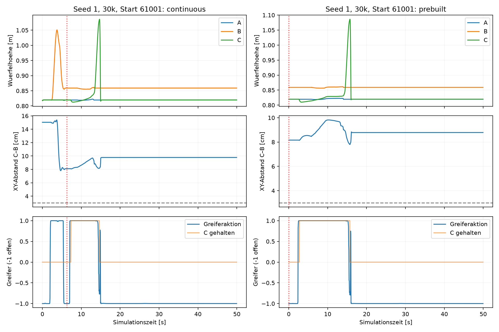

# Replay-Diagnose: Zwei-zu-Drei-Komposition

Ergaenzung: Die [kontrollierte Hoehenablation](../height_ablation/REPORT.md) ist abgeschlossen. Bei exakt gepaarten Roboter-/Quellzustaenden scheitern alle drei untersuchten Checkpoints bei +2 bis +4 cm (je Hoehe 0/15), gegenueber 8/15 bei 0 cm. Designgrenzen und Teilereignisse stehen im neuen Bericht.

30 Diagnoseepisoden, keine Trainingsupdates. Drei vorhandene Checkpoints, fuenf vorab festgelegte Entwicklungsstarts (61000–61004), zwei Bedingungen. Keine neuen Teststarts zur Modellwahl verwendet.

## Ergebnisse

| Modell | Bedingung | Zweite Fertigkeit | C gegriffen | C angehoben | Naeher als 3 cm* | Kontakt am Ziel* | Stabil |
|---|---|---:|---:|---:|---:|---:|---:|
| relative_seed1 / 30000 | continuous | 3/5 | 3/5 | 2/5 | 0/5 | 0/5 | 0/5 |
| relative_seed1 / 30000 | prebuilt | 5/5 | 3/5 | 1/5 | 0/5 | 0/5 | 0/5 |
| relative_seed2 / 10000 | continuous | 4/5 | 2/5 | 0/5 | 0/5 | 0/5 | 0/5 |
| relative_seed2 / 10000 | prebuilt | 5/5 | 5/5 | 4/5 | 3/5 | 0/5 | 0/5 |
| relative_seed2 / 30000 | continuous | 5/5 | 4/5 | 2/5 | 2/5 | 0/5 | 0/5 |
| relative_seed2 / 30000 | prebuilt | 5/5 | 4/5 | 2/5 | 0/5 | 0/5 | 0/5 |

* Nach Anheben von C ueber z=0,88 m. Zielkontakt verlangt zusaetzlich XY <9 mm, Hoehendifferenz 40 mm ±8 mm und echten B–C-Kontakt. Ereignisse gelten waehrend der zweiten Fertigkeit; die Tabellenzaehler sind keine zwingend verschachtelte Fehlerklassifikation.

## Interpretation

Der vorbereitete Zweierstapel loest das Problem nicht: auch diese zweite Teilaufgabe scheitert in allen 15 Episoden. Ein ausschliesslich fehlerhafter Uebergang von der ersten zur zweiten Fertigkeit erklaert die beobachteten Ergebnisse deshalb nicht. Das beweist jedoch keine einzelne Ursache: Vorbereitung aendert Objektpositionen, Vorgeschichte und Roboterstartpose gleichzeitig. Fuenf Starts pro Checkpoint sind eine begrenzte Entwicklungsdiagnose.

Die Trainingsdaten enthalten fuer Ziel-z minus Quellwuerfel-z Werte von -23.56 bis 0.89 cm; an jedem Demostart ist die Differenz null. Die vorbereitete zweite Teilaufgabe beginnt dagegen mit rund +4 cm. Diese relative Hoehenbeziehung liegt ausserhalb des beobachteten Trainingsbereichs. Relative Koordinaten allein entfernen diese Verteilungsverschiebung nicht. Dies ist ein nachgewiesener Abdeckungsunterschied, noch kein isolierter kausaler Beweis.

Die Fehler treten bereits beim Greifen/Anheben und beim Transport auf. Daher waere eine ausschliessliche Optimierung des Loslassens zu eng. Teilweise wird der untere Stapel aus seiner Geometrietoleranz gebracht; das darf ohne weitere Kontakt-/Kraftanalyse nicht pauschal als Greiferkollision bezeichnet werden.

Konkretes Beispiel: relative Seed 1, 30.000 Updates, Start 61001. Im kontinuierlichen Ablauf beginnt die zweite Fertigkeit nach 6,25 s. C wird angehoben, bleibt nach dem Anheben aber mindestens 8,16 cm horizontal vom Ziel entfernt. Ab Schritt 291 (etwa 14,6 s) wird der Greifer deutlich geoeffnet, obwohl C noch angehoben und weit vom Ziel entfernt ist; danach geht der Grasp verloren und C faellt auf den Tisch. Mit vorbereitetem Stapel tritt bei demselben Start ein aehnlicher Ablauf auf (minimal 7,80 cm Abstand nach Lift). Das ist ein direkt beobachtetes vorzeitiges Oeffnen ohne vorherige Zielpositionierung; nicht alle anderen Fehlversuche folgen diesem Muster.

[Video: kompletter Ablauf, Start 61001](illustration_seed1_u30000/continuous_61001.mp4) · [Video: vorbereiteter Stapel, gleicher Start](illustration_seed1_u30000/prebuilt_61001.mp4). Die beiden Zusatzreplays illustrieren bereits enthaltene Faelle und werden nicht als weitere unabhaengige Episoden gezaehlt.

## Reproduzierbarkeit und Artefakte

- Alle 15 kontinuierlichen Replays stimmen bei Initialzustand-Hash, erstem Paarwechsel und Gesamterfolg mit den gespeicherten Originalepisoden ueberein.
- Alle 15 vorbereiteten Tuerme wurden nach 40 neutralen Simulationsschritten auf den vorhandenen Kontakt-/Stabilitaetscheck geprueft.
- Checkpoint-Hashes vor und nach der Untersuchung unveraendert. Datensatz nur lesend geoeffnet.
- NPZ je Episode enthaelt Initialzustand, Startzustand nach Vorbereitung und pro Schritt Positionen, EEF, Aktionen, Grasp, Greiferkontakte, Objektkontakte, Stabilitaet und Geschwindigkeiten. Spaltenschema in protocol.json.
- MP4 und Bildstreifen fuer den vorab festgelegten Start 61000 pro Checkpoint/Bedingung. Zusatzvideo fuer Start 61001 kann den Uebergang illustrieren; keine zusaetzlichen unabhaengigen Versuche.

## Konsequenz fuer den naechsten Methodenversuch

Zuerst eine Hoehenablation mit kontrolliert gleicher Quellposition und Roboterstartpose sowie separat einen Uebergang mit zurueckgezogenem Greifer pruefen. Das trennt Einfluesse besser als der hier verwendete grobe Vorbereitungseingriff. Kein Erfolg dieser Diagnose darf als vollstaendige Dreier-Loesung gezaehlt werden.

Fuer das unveraenderte Ziel (nur Zwei-Wuerfel-Demos) ist anschliessend eine explizit getrennte, gelernte Greif-/Transport-/Platzierdarstellung eine begruendete Hypothese: Die Greifphase sollte nicht unnoetig von der unbekannten Zielhoehe abhaengen, die Platzierphase muss relativ zum Ziel arbeiten. Phasenlabels koennten ausschliesslich aus vorhandenen Demos abgeleitet werden; Controlleranteile und Regeln muessen ausgewiesen und gegen dieselbe BC-Baseline getestet werden. Dies ist ein Vorschlag, keine bereits implementierte oder nachgewiesen erfolgreiche Methode.

Mehr Updates allein sind durch diese Befunde nicht als Loesung begruendet. Das 90%-Ziel bleibt unerreicht.
