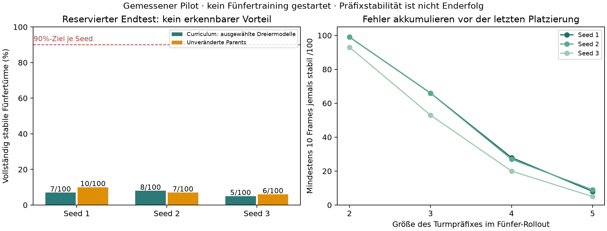

> **Messkorrektur24.10.2026:** Die zusätzliche Prüfung vollständiger Fingerkontaktfreiheit war wegen eines Gripper-Dictionary-Fehlers unwirksam. Historische Quoten gelten für die damalige implementierte Metrik. [Details und Grenzen](MEASUREMENT_CORRECTION.md).

# Fünferturm-Pilot: vertiefte Auswertung

Stand:24.10.2026, Agentanalyse nach vollständigem Prozessabschluss. **90%-Ziel klar verfehlt. Kein Vorteil des realisierten Curriculum-Pfads erkennbar.** Alle24 vorgesehenen Endtestreihen wurden vollständig ausgeführt, insgesamt1500 Episoden. Der geplante Vergleich zweier tatsächlich auf Fünfern trainierter Methoden kam wegen der vorab festgelegten Gates nicht zustande. Der Pilot ist abgeschlossen; dies ist kein erfolgreicher Abschluss des Fünfer-Lernziels.

## Gemessene Endergebnisse

| Modell/Seed | 2 Würfel | 3 Würfel | 4 Würfel | 5 Würfel |
|---|---:|---:|---:|---:|
| Curriculum 1 | 47/50 | 27/50 | 17/50 | 7/100 |
| Curriculum 2 | 48/50 | 28/50 | 19/50 | 8/100 |
| Curriculum 3 | 48/50 | 18/50 | 13/50 | 5/100 |
| Parent/Kontrolle 1 | 47/50 | 29/50 | 18/50 | 10/100 |
| Parent/Kontrolle 2 | 49/50 | 27/50 | 19/50 | 7/100 |
| Parent/Kontrolle 3 | 47/50 | 16/50 | 10/50 | 6/100 |

Die Bezeichnung Curriculum meint hier die eingefrorenen, nach zusätzlichem Dreiertraining ausgewählten Modelle. Alle Viererkandidaten wurden verworfen. Der Direktarm blieb wegen zu weniger erfolgreicher Fünferdaten bei seinen unveränderten Parentgewichten. Deshalb zeigt die Tabelle **Dreierfortsetzung gegen Parent**, keinen budgetgleichen Vergleich zweier Fünfertrainingsverfahren.

Auf denselben100 reservierten Fünferstarts pro Modellseed liegen die Differenzen bei−3,+1,−1 Prozentpunkten. Gepaarte unterschiedliche Ausgänge:Seed1 Curriculum-only0/Parent-only3;Seed2 2/1;Seed3 0/1. Die Initialzustandshashes stimmen jeweils paarweise überein. Deskriptiv20/300 gegenüber23/300 Erfolge; diese Poolzahl ist wegen gemeinsamer Starts und nur drei Lernreplikaten kein unabhängiger300-Seed-Nachweis. Auch auf Dreiern ist der im Entwicklungsset sichtbare Gewinn im Endtest nicht konsistent:−2,+1,+2 Erfolge je50. Kein Endtest wurde für neue Modellwahl oder Optimierung verwendet.

## Warum das Training früher endete

Ausgangs-Dreiergate:Seed1 34/50, Bestätigung29/50;Seed2 31/50, Bestätigung28/50;Seed3 27/50 ohne Bestätigungsversuch. Zunächst bestand kein Parent das doppelte60%-Gate.

Nach30.000 neuen Dreierupdates pro Seed:37/50 mit31/50 Bestätigung,33/50 mit29/50 Bestätigung,28/50 ohne Bestätigung. NurSeed1 durfte als Teacher zum Sammeln von Vierern dienen. Das Gate beweist nicht, dass alle drei Modelle60% schaffen; es war ein praktisches Sammelgate auf Entwicklung, kein Konfidenzbeweis.

Die Vierersammlung lieferte27/100 erfolgreiche Trainingsepisoden und8/20 erfolgreiche Validierungsepisoden, erfüllte also das Datengate. Nach weiteren30.000 Updates pro Seed erzielten die Kandidaten13/50,13/50,10/50. Ihre direkten Dreier-Parentgewichte erzielten15/50,13/50,12/50. Bei Gleichstand blieb ebenfalls der Parent. Damit wurden alle Viererkandidaten verworfen; ihre Updates und Kosten bleiben dennoch Teil der Bilanz. Die ausgewählten Modelle lagen auf Vierern bei15/50,13/50,12/50 und verfehlten das30/50-Gate deutlich. Die Curriculum-Fünfersammlung und das120.000-Update-Fünfertraining wurden deshalb nicht betreten.

Die direkte Fünfersammlung mit den ursprünglichen drei Parents ergab6/100 erfolgreiche Trainingsepisoden und3/20 erfolgreiche Validierungsepisoden. Das Minimum20 Trainingserfolge wurde verfehlt. Kein direkter180.000-Update-Trainingslauf wurde gestartet. Dies ist ein Datenverfügbarkeitsbefund; seine Erfolgsrate ist nicht0/100. Die spätere Parent-Endtestrate beträgt5er10/7/6 von100.

## Echte Updates, Auswahl und Lernkurven

Alle sechs Produktionsläufe haben tatsächlich30.000 Updates:je drei auf Dreier- und Viererdaten. Latest- und Best-Gewichte stimmen innerhalb eines Laufs überein; die Auswahl prüfte nur den abgeschlossenen Endcheckpoint gegen seinen Parent. Best bedeutet hier **kein** fortlaufend in Simulation gesuchtes Optimum. Die protokollierten10k-Zwischenpunkte enthalten nur Offlinevalidierung; ein früherer besserer Rolloutcheckpoint wurde nicht untersucht.

Optimizerzustände und endliche Gewichte wurden geprüft; maximale Adam-Schrittzahl jeweils30.000. Die L2-Änderungen gegenüber dem Parent liegen auf Dreiern bei1,677/1,610/2,328 und auf Vierern bei1,233/1,392/2,207: Es fanden echte Modellupdates statt. Alle aufgezeichneten Losses sind endlich. Kleine Action-MSE-Werte reichen nicht als Nachweis für lange stabile Türme. Insbesondere Seed3 besitzt weiterhin viele falsche Phasenabschlussvorhersagen im ursprünglichen Validierungsset; auch diese Offlinewerte erklären den Rollouterfolg nicht allein.

Pro Seed wurden60.000 zusätzliche Updates mit Batch64 bezahlt, entsprechend140.55 Originaldatenpass-Äquivalenten bei27.322 Originaltrainingsframes. Die ausgewählten Modelle enthalten nur die erste30.000-Update-Fortsetzung, entsprechend70.27 Äquivalenten. Über alle Seeds180.000 Updates und11,52Mio verarbeitete Batchbeispiele. Bei50% Originalmasse beträgt die tatsächliche Originalexposition je Seed etwa70,27 Originaldatenpässe; die140,55-Zahl normiert dagegen sämtliche Mischbeispiele auf die Originalgröße. Keine dieser Zahlen ist eine klassische Epoche über den wachsenden gemischten Datensatz. Historische Vortrainingskosten sind zusätzlich und wurden hier nicht erneut bezahlt. Zwei5-Update-Techniksmokes werden separat geführt.

## Wo die Fünfer-Rollouts scheitern

Die vollständigen Ereigniszusammenfassungen aller100 Starts je Seed zeigen:

| Seed | 2er-Präfix ≥10 Frames | 3er-Präfix | 4er-Präfix | 5er-Präfix | 5er-Enderfolg ≥50 Frames |
|---|---:|---:|---:|---:|---:|
| 1 | 99 | 66 | 28 | 8 | 7 |
| 2 | 99 | 66 | 27 | 9 | 8 |
| 3 | 93 | 53 | 20 | 5 | 5 |

Jede Präfixzahl bedeutet, dass das gesamte jeweilige untere Präfix irgendwann mindestens10 Frames gültig war. Das ist weder eine isolierte Platzierungsgenauigkeit noch garantierter späterer Turmerhalt. Trotz93–99 kurzzeitig gültiger Zweiertürme bleiben nur20–28 gültige Viererpräfixe und5–9 gültige Fünferpräfixe übrig. Der Verlust tritt also über mehrere Paarwechsel auf, nicht ausschließlich bei der fünften Freigabe. Beim Curriculum scheitern in der letzten aktiven Paarstufe2/3/4 jeweils33/38/21 Episoden fürSeed1,33/39/19 fürSeed2 und40/33/15 fürSeed3; zusätzlich1/1/7 in Stufe1. Das sind Endzustandskategorien, keine nachgewiesenen kausalen Fehlerursachen.

Nur die ersten zwei festgelegten Endtestepisoden pro Modell wurden als vollständige Zeitreihe archiviert. In allen sechs untersuchten Verläufen auf Start365000 verliert das untere Zweierpräfix innerhalb40 Schritten nach dem ersten Paarwechsel mindestens einmal die strenge Gültigkeit. Auf365001 treten bei mehreren Modellen zusätzliche Gültigkeitsverluste nach späteren Wechseln auf. Diese gepaarten12 gespeicherten Verläufe stützen eine Übergangsdiagnose, erlauben aber keine repräsentative Fehlerrate für alle600 Episoden. Gültigkeitsverlust kann Bewegung, Kontakt oder Geometrie bedeuten; er wird nicht automatisch als dauerhafter Einsturz bezeichnet.

Eine belastbare Millimeterverteilung der letzten Platzierung für alle erfolgreichen Endtests ist mit nur zwei gespeicherten Zeitreihen pro Modell nicht nachträglich rekonstruierbar. Das globale Kriterium verlangtXY≤9mm zwischen jedem Nachbarpaar sowie40mm±8mm Höhendifferenz, reale Kontakte, niedrige Geschwindigkeiten und keine Fingerkontakte über50 Frames. Erfolgsquoten sind vollständig gemessen, feinere Platzierungsverteilungen fehlen. Es wurden dafür keine reservierten Tests erneut abgespielt.

## Daten, Controller und Kosten

Neu gesammelt wurden360 feste Episoden mit450.331 Simulations-Steuerschritten. Entwicklung und Gates kosteten1250 Episoden/1.030.356 Schritte; reservierte Endtests1500 Episoden/1.765.223 Schritte. Zusammen3110 Episoden und3,245,910 Steuerschritte. Wiederholte Entwicklungs-/Gatestarts zählen als reale Kosten, jedoch nicht als zusätzliche unabhängige Starts. Die technische Episode399001 (685 Schritte) sowie vorbereitete reine Physiktests und historische Demos sind in dieser Hauptbilanz ausgeschlossen.

Sessionstart23.10.21:17:08UTC, Workerabschluss24.10.02:46:26UTC, Supervisorabschluss02:46:28UTC; Gesamtzeit einschließlich Vorbereitung etwa5.49h. Die12h waren eine Obergrenze, kein Auftrag, nach negativen Gates weitere unlimitierte Versuche zu erzeugen. GPU-Kernzeit und Energie wurden nicht gemessen; die Angabe ist reale Sessiondauer einschließlich Simulation und Tests. Die Fristen07:17:08UTC für Training und09:17:08UTC gesamt wurden eingehalten.

Architektur und10 Eingaben blieben unverändert:EEF-Ankerdifferenz, Orientierung, Fingerpositionen und Phasenzeit. Sieben BC-Phasen erzeugen Aktionen und Abschlusswahrscheinlichkeit. Ein externer Sequencer wählt Quell-/Zielwürfel und wartet auf freigegebenes stabiles Präfix; ein gelernter Phase0-Rückzug wird zwischen Paaren wiederverwendet. Das System ist damit ein explizit komponierter Controller mit gelernten Teilaktionen. Der restliche Turm ist kein expliziter Policyinput. Alle Ergebnisse enthalten bereits erfolgreiche eigene Dreierdaten aus der Vorgängersession; kein Beleg für reine Zero-shot-Generalisation aus ausschließlich Zweiertraining.

Die Datensatzprüfung steht in DATASET_REPORT.md. Original-HDF5-SHA256:5222cbf96dc6218389d491fe7b99449295dcfc9bceb3bab8f8776ffff19fe6f8. Original, eingefrorene Quellen, Arrays, Parentmanifest und alle sechs ausgewählten Gewichte sind erneut hashgeprüft. Split-/Pre-action-Audits für alle360 Dateien wurden in den stündlichen Checks abgeschlossen. Supervisor und Worker sind beendet; keine Session-Pythonprozesse mehr vorhanden, Wachhaltesperre bestätigt freigegeben(process_closeout.json).

## Konsequenz für die Hypothese und nächsten Versuch

Die Idee, bei60% Gesamtleistung erfolgreiche eigene Daten zu sammeln, ist als Datenerzeugung plausibel, hat hier aber den Aufstieg nach vier Würfeln nicht ermöglicht. Die universelle Behauptung „pro Würfel kurz weitertrainieren, danach nur den Fünfer lange trainieren“ wird durch diesen Pilot nicht gestützt. Eine allgemeine Überlegenheit oder Untauglichkeit von Curricula ist damit ebenfalls nicht bewiesen: Es fehlt der realisierte trainierte Fünfervergleich, und der getestete Actor sieht den unteren Turm nicht explizit.

Ein nächster vorab registrierter Versuch sollte zuerst auf **Viererleistung und Erhalt des unteren Turms bei Paarwechseln** zielen. Getrennt vergleichen:unveränderter Actor mit gezielter Auswahl erfolgreicher höherer Übergänge gegen einen neuen Actor mit Turm-/Freirauminformation. Architekturwechsel wäre ein eigener Methodenfaktor und braucht eine neue Baseline. Für reine Self-Imitation bleibt die Erfolgsfilterung erhalten; seltene erfolgreiche Endepisoden liefern jedoch keine Abdeckung gescheiterter Wiederherstellung. Ohne neue Information oder zusätzliche erfolgreiche Zustandsabdeckung garantiert längeres Kopieren eigener Aktionen keinen Gewinn.

Completionfehler und Rückzugs-/Transportverhalten zunächst auf **neuen Entwicklungsstarts** mit vollständigen Zeitreihen untersuchen; danach kleinen budgetgleichen Trainingsvergleich und2/3/4-Regression, erst bei bestätigtem Vierergate erneut auf fünf aufsteigen. Die jetzt benutzten Endtestbereiche sind dauerhaft für Optimierung gesperrt. Ein strenger kausaler Curriculumvergleich braucht auf beiden Armen tatsächlich verfügbare Daten und angeglichene bezahlte Updates/Sammelschritte oder muss Blockaden explizit als Resultat ausweisen. Ein Vergleich mit RL ohneIL wurde nicht implementiert; eine Epochenersparnis gegenüberRL bleibt unbekannt.

Kein weiterer Lauf wurde gestartet. Maschinell prüfbare Details:final_analysis.json, five_cube_endtest_analysis.json, dataset_audit_*.json, source_hashes.json und agent_checks.jsonl. Der automatische Rohbericht ist unverändert als RESULTS_AUTOMATIC.md erhalten.
