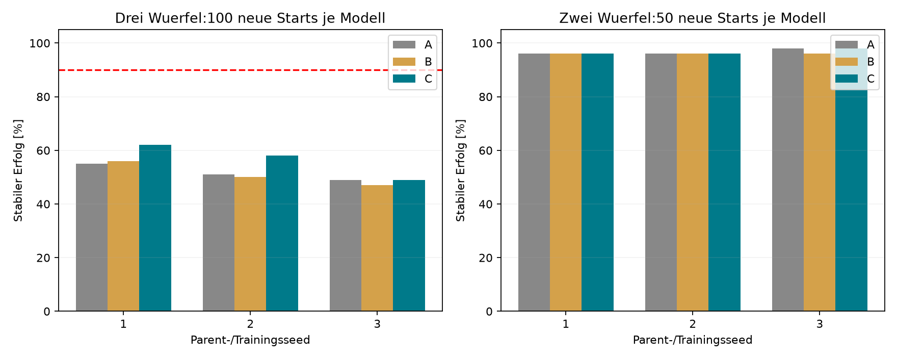

> **Messkorrektur24.10.2026:** Die zusätzliche Fingerkontaktfreiheitsprüfung war wegen eines Gripper-Dictionary-Fehlers nicht zuverlässig. Historische Quoten gelten für die damalige Metrik. [Details](../stack_five_curriculum_20261023/MEASUREMENT_CORRECTION.md).

# Self-Imitation-Pilot: Ergebnis und Entscheidung

**Begrenzter positiver Effekt eigener Dreierdaten,90%-Ziel verfehlt.** Alle neun Modelle absolvierten30.000 zusaetzliche Updates. Alle1350 Endtestepisoden sind vollstaendig,900 davon Dreiertests. ArmC erreicht im Dreiertest62/58/49%, gegenueber55/51/49% inA und56/50/47% inB. Mittelwerte:C56,3%,A51,7%,B51,0%.

A:100% Originaldaten. B:75%Original+25% erfolgreiche eigene Zweier. C:75%Original+25% erfolgreiche eigene Dreier. Frischer gleicher AdamW pro gepaartem Arm,3e-5, Batch64; identische Ausgangsgewichte innerhalb jedes Parentseeds. Der Abschlussklassifikator wird ausschliesslich aus Originalexpertendaten weitertrainiert. Alle Arme nutzen denselben Controller samt Rueckzug.

| Arm | Dreier Seed1 /100 | Seed2 /100 | Seed3 /100 | Zweier Seed1 /50 | Seed2 /50 | Seed3 /50 |
|---|---:|---:|---:|---:|---:|---:|
| A | 55 | 51 | 49 | 48 | 48 | 49 |
| B | 56 | 50 | 47 | 48 | 48 | 48 |
| C | 62 | 58 | 49 | 48 | 48 | 49 |

## Was ist durch den Vergleich gedeckt?

C gegenA:+7,+7,0 Prozentpunkte. C gegenB:+6,+8,+2 Prozentpunkte. Eigene Zweierdaten allein zeigen mit+1,-1,-2 Punkten gegenA keinen konsistenten Vorteil. Eigene Dreierdaten helfen in diesem konkreten Pilot eher als allgemeine zusaetzliche Selbstdaten; der Unterschied ist klein und nicht bei allen Parents gegenA positiv. Drei Parentmodelle sind keine Grundlage fuer eine breite Signifikanzbehauptung. Starts sind innerhalb der Modelle gepaart, nicht zusaetzliche unabhaengige Trainingsreplikate.

Gepaarte gewonnene/verlorene Dreierstarts mitC:
- C_minus_A_seed1: 8 gewonnen, 1 verloren.
- C_minus_B_seed1: 8 gewonnen, 2 verloren.
- C_minus_A_seed2: 8 gewonnen, 1 verloren.
- C_minus_B_seed2: 9 gewonnen, 1 verloren.
- C_minus_A_seed3: 2 gewonnen, 2 verloren.
- C_minus_B_seed3: 2 gewonnen, 0 verloren.

Die Zweier-Erfolge liegen bei96–98% in allen Armen. In diesen50 Tests pro Modell ist keine grosse Zweierregression erkennbar; eine Verschlechterung um einzelne Episoden bleibt moeglich. Das ist kein Beweis vollstaendiger Nichtverschlechterung.

## Teacher und Modellauswahl

Die unveraenderten Teacher wurden auf denselben50 Entwicklungsstarts bewertet, nicht auf den finalen100 Teststarts dieses Piloten. Vergleich daher nur innerhalb der Entwicklung, kein unbelegter Testvergleich mit historischen62/48/50% auf anderen Szenen.

| Seed | Teacher Dev /50 | A best Dev /50 (Updates) | B best Dev /50 (Updates) | C best Dev /50 (Updates) |
|---|---:|---|---|---|
| 1 | 33 | 34 (10000) | 34 (10000) | 38 (10000) |
| 2 | 26 | 29 (3000) | 30 (10000) | 35 (30000) |
| 3 | 29 | 31 (10000) | 31 (30000) | 32 (30000) |

Checkpoints wurden nach Dreier-Dev-Erfolg, bei Gleichstand Zweier-Erfolg und dann frueherem Update gewaehlt. Alle neun Gewichte wurden vor dem ersten Endtest kopiert und gehasht. Die gespeicherten Endhashes stimmen weiterhin. Dass fruehe Checkpoints teilweise besser sind als30.000 Updates, spricht gegen blindes Weitertrainieren. Die gesamte bezahlte Trainingsmenge ist270.000 Updates, auch wenn ein frueherer Checkpoint zum Endtest gewaehlt wurde.

## Datenqualitaet und tatsaechlicher Lernimpuls

Neue Daten:286 erfolgreiche Zweier-Trainingsepisoden und99 Zweier-Validierungsepisoden;154 erfolgreiche Dreier-Trainingsepisoden und56 Dreier-Validierungsepisoden.800 feste Sammelversuche, alle Fehlschlaege archiviert. Pre-action-Inputs, zeitliche Verkettung, endliche Werte und Erfolg wurden unabhaengig geprueft; keine identischen Initialzustand-Hashes zwischen Training und Validierung. DATASET_REPORT.md dokumentiert die Aufschluesselung pro Teacher.

Die Teacher liefern erfolgreiche Policy-Daten, keinen neuen unabhaengigen Experten. Das Ergebnis ist Self-Imitation/Teacherpool-Destillation nach einem Start aus Zweier-Expertendaten. SobaldC mitDreierrollouts trainiert wird, ist seine Datenbedingung keine reine Zero-shot-Generalisation ausschliesslich aus Zweier-Trainingsdemos mehr.

Die Aktions-MSE auf neuen Beispielen vor Update1 ist nicht null, weil der Datensatz von drei unterschiedlichen Teachern stammt. B liegt je Parent bei ca.5,1e-5 bis8,5e-5, C bei5,34e-4 bis2,16e-3. Der Lernimpuls ist daher unter anderem Nachahmung anderer Teacher auf neuen Zustaenden; der Versuch isoliert keinen Vorteil einer exakten Selbstkopie. Bei denselben Inputs und identischem Teacher waere der anfängliche Actorgradient exakt null. Die Erfolgsfilterung und ihr Selektionsbias sind ebenfalls nicht durch einen ungefilterten Kontrollarm isoliert.

## Fehler und Platzierungsqualitaet

Die Einzelzeitreihen wurden auf endliche Werte geprueft und alle1350 Erfolge aus mindestens50 kontinuierlichen valid-Frames erneut berechnet. Folgende Werte beschreiben erste Paarplatzierung, Fehlschlaege mit zeitweisem Verlust der unteren Geometrie und mittleren C–B-Mittenversatz am Ende erfolgreicher Tuerme. Geometrieverlust beweist keine konkrete Kollisionsursache; der Versatz gilt ausschliesslich fuer Erfolge.

| Modell | Erster Stapel /100 | Fehler mit unterem Geometrieverlust | XY-Mittel erfolgreicher Tuerme [mm] |
|---|---:|---:|---:|
| A_seed1 | 98 | 39 | 2.78 |
| A_seed2 | 96 | 42 | 2.91 |
| A_seed3 | 95 | 39 | 3.30 |
| B_seed1 | 98 | 38 | 2.79 |
| B_seed2 | 97 | 45 | 2.95 |
| B_seed3 | 93 | 41 | 3.23 |
| C_seed1 | 98 | 34 | 2.90 |
| C_seed2 | 99 | 40 | 2.91 |
| C_seed3 | 94 | 39 | 3.26 |

## Aufwand, Grenzen und naechster Schritt

Zeit von Protokollanlage bis Supervisorabschluss ca.4.22h inklusive Vorbereitung, Unterbrechung/Reparatur und Warte-/Evaluationszeiten. Summe der neun Trainingslaeufe inklusive ihrer Entwicklungsbewertungen:2.18h. Das sind keine reinen GPU-Optimierungsstunden. Ausgefuehrt wurden800 Sammelversuche,300 Teacher-Baselineepisoden,2700 Entwicklungsbewertungen und1350 Endtests, zuzueglich technischer Vorpruefungen. Die urspruengliche Deadline wurde nicht verlaengert. Ein technischer Abbruch der batched Aktionsvalidierung wurde nach exakter Einzelbildreproduktion behoben; keine wissenschaftliche Gateanpassung und keine alten Trainingsdaten ersetzt.

Ergebnisentscheidung: C ist ein sinnvoller neuer Ausgangspunkt fuer weitere kontrollierte Entwicklung, aber die einfache Aggregation erfolgreicher Episoden schliesst die Zuverlaessigkeitsluecke nicht. Eine weitere blinde Sammel-/Trainingsrunde ist durch diesen Pilot nicht begruendet. Zuerst die erhaltenen Fehlerstarts mit Kontakt-/Bahnverlaeufen untersuchen und pruefen, ob eine Turm-/Freiraumdarstellung oder kompetente Korrekturlabels fuer die Fehlzustaende erforderlich sind. Eine solche Aenderung waere ein neuer Methodenversuch. Kein weiterer Trainingslauf wurde hier gestartet.

Die Modelle sehen nur Ankerrelativlage, Orientierung, Finger und Phasenzeit; Lage des restlichen Turms und Hindernisse fehlen als explizite Eingaben. Eine passende Bahn kann kopiert werden, aber eine nicht im Input unterscheidbare Gefahr nicht automatisch erkannt werden. Feste Phasen-/Paarreihenfolge, Rueckzugsregel, privilegierte Simulatorzustaende und physische Gates bleiben Bestandteil aller Resultate.

Die finalen125000er/126000er Szenen sind nach dieser Auswertung verbrauchte Endtests. Bei weiterer Methodenwahl neue Tests reservieren.90% wurden von keinem der neun Modelle erreicht; weniger Updates bis90% sind folglich ebenfalls nicht nachgewiesen. Originaldatensatz und Parentcheckpoint-Hashes wurden nochmals geprueft und sind unveraendert. Sampler-Endzustaende des Originaldatensamplers sind ueberA/B/C je Parent identisch. Vergleichbarkeit der Ausgangsgewichte und Updatebudgets ist geprueft.

Nachweise: analysis.json, training_verification.json, dataset_audit.json, final_test/selection.json, alle Konfigurationen/Checkpoints/NPZ-Rollouts. Ein abschliessender Prozesscheck steht in process_closeout.json.

Abschlusscheck: Supervisor Returncode0; alle geprueften bekannten Sessionprozesse beendet. Seine threadgebundene Wachhaltesperre ist freigegeben. Siehe process_closeout.json. Die abgeschlossene Ueberwachung wird entfernt.
