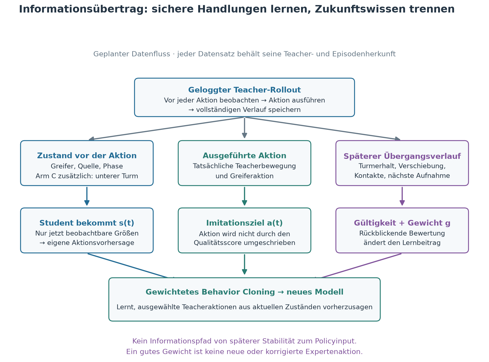
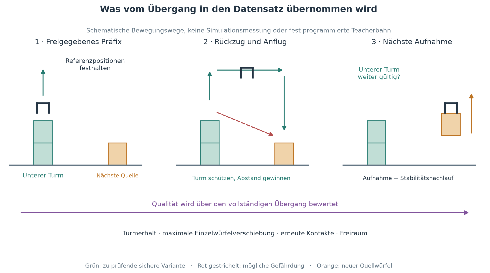
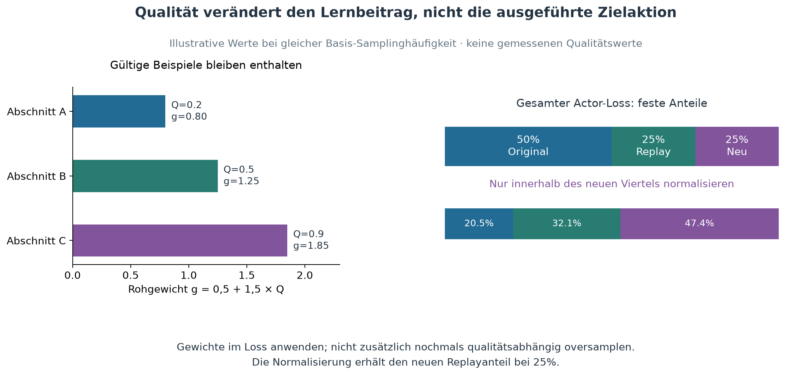

> **Abschluss der Vorbereitung:** Alle Startgates bestanden; aktuelle Abnahme in [EXECUTION_READINESS.md](EXECUTION_READINESS.md), Daten in [DATASET_REPORT.md](DATASET_REPORT.md). Frühere offene Punkte unten sind historische Zwischenstände. Freigabe zum Langlauf steht aus.

> **Aktualisierung24.10.2026:** Ausführbarer Daten-/Smoke-Kern und unabhängiges Audit liegen vor. Der konkrete erste Vergleich ist B0/B mit Score ohne Clearance; C bleibt zurückgestellt. [Neuer Laufplan und offene Startgates](TRAINING_RUN_PLAN.md) · [Audit](AUDIT_FINDINGS.md) · [Codevalidierung](IMPLEMENTATION_VALIDATION.md). Die historische Fingerkontaktmessung war fehlerhaft; siehe [Messkorrektur](../stack_five_curriculum_20261023/MEASUREMENT_CORRECTION.md).

# Qualitätsgewichtetes Übergangslernen

Stand: 24.10.2026. **Implementierter und technisch geprüfter Versuchsplan; produktives Training noch nicht gestartet.** Die Grafiken erklären den geplanten Informationsfluss; sie sind keine neuen Simulationsergebnisse.

Ziel: Den nächsten Würfel aufnehmen und anheben, während der bereits gebaute untere Turm erhalten bleibt. Erst danach wieder längere vollständige Vierer-/Fünfertürme optimieren.

## Ausgangslage und Hypothese

Im abgeschlossenen Pilot lagen vollständige Fünfertürme nach Dreierfortsetzung bei 7/100, 8/100 und 5/100; die unveränderten Parents erreichten 10/100, 7/100 und 6/100. Viererkandidaten verbesserten ihre Entwicklungsergebnisse nicht. Der geplante eigentliche Fünfertrainingsvergleich wurde wegen der Gates nicht ausgeführt. Quelle: [Abschlussbericht](../stack_five_curriculum_20261023/RESULTS.md).

Gespeicherte Zeitreihen zeigen Verluste der strengen Gültigkeit des unteren Turms nach Paarwechseln. Das ist eine begrenzte diagnostische Stichprobe, kein Beweis, dass jeder Fehler durch Rückzug verursacht wird. Deshalb messen wir Übergänge gezielt und unterscheiden Berührung, Verschiebung, kurzzeitige Bewegung und dauerhaften Einsturz.

**H1:** Bei gleichem Actor, denselben Parents und gleichem Updatebudget verbessert Qualitätsgewichtung nachweislich sicherer Übergangsabschnitte den Turmerhalt gegenüber bisheriger Erfolgsfilterung.

**H2:** Zusätzliche Informationen über den unteren Turm verbessern diese Leistung über H1 hinaus. Das ist ein separater Architekturvergleich.

Weder H1 noch H2 ist bereits bestätigt. Erfolgsfilterung und Gewichtung schaffen keine neuen korrekten Aktionen. Wenn der Student die Teacheraktionen bereits exakt reproduziert, ist der Action-MSE-Gradient dort null; eine andere Gewichtung ändert daran allein nichts. Der gepoolte Datensatz muss zusätzliche sichere Zustände oder unterschiedliche, bessere Teacherbewegungen beitragen. Vor Training deshalb den Ausgangsfehler und die Unterschiede zwischen Teachern messen.

## 1. Informationsfluss: Was wird tatsächlich übertragen?

Aus einer Simulation entstehen drei getrennte Kanäle:

| Kanal | Inhalt | Verwendung |
|---|---|---|
| Vor der Aktion beobachteter Zustand | Greifer, Würfel, Kontakte, Phase, gegebenenfalls Vergangenheit | Eingabe für den Student |
| Tatsächlich ausgeführte Teacheraktion | Kartesische Bewegung und Greiferaktion | Imitationsziel, keine aus Qualität erfundene Ersatzaktion |
| Ergebnis des folgenden Übergangs | Turmerhalt, Verschiebung, Berührungen, Aufnahmeerfolg | Gültigkeit und Trainingsgewicht |

**Nachherwissen darf das Gewicht eines Beispiels bestimmen, aber nicht dessen Policyinput.** Die Qualität bewertet eine beobachtete Handlung rückblickend. Beim Einsatz muss das Modell ohne Wissen über den zukünftigen Ausgang entscheiden. Auch neue Inputnormalisierung wird ausschließlich mit Trainingsdaten bestimmt.

Die bisherigen erfolgreichen eigenen Rollouts sind keine neuen unabhängigen Experten. Herkunft und Teacherhash bleiben gespeichert. Neue Informationen entstehen hier durch andere erfolgreiche Zustände, sichere Übergangsvarianten, die Zusammenführung verschiedener Teacher und gegebenenfalls zusätzliche aktuelle Beobachtungen. Ein großer Datenumfang allein ist kein Nachweis für diesen Informationsgewinn.

## 2. Die Einheit des Datensatzes ist ein Übergang

Ein Abschnitt enthält Freigabe, Rückzug, Anflug auf den nächsten Würfel sowie dessen Aufnahme/Anheben. Der untere Turm besteht aus den bereits platzierten Würfeln; der neue Quellwürfel gehört noch nicht dazu. Kontakt mit diesem Quellwürfel beim Greifen ist erwünscht und wird nicht als Turmberührung bestraft.

Vorgesehene Ereignisse:

1. `placed`: letzter Würfel platziert; vorheriger Verlauf bleibt zur Diagnose gespeichert.
2. `released_stable`: unteres Präfix ist mindestens zehn aufeinanderfolgende Steuerframes gültig und frei von Fingerkontakt. Referenzpositionen des Turms festhalten.
3. `retreat`: Greifer entfernt sich; Beginn und Ende getrennt markieren.
4. `next_pickup`: nächster Quellwürfel wird gegriffen und angehoben, ohne den unteren Turm aufzugeben.
5. `confirmed`: unteres Präfix besteht den anschließenden Stabilitätsnachlauf.

Ereignisse werden aus tatsächlich geloggten Zuständen abgeleitet; keine Teleports im vollständigen Rollout. Startwerte für ein neues Protokoll: maximal 200 Steuerframes zwischen Freigabe und erfolgreicher nächster Aufnahme, danach 50 Frames Stabilitätsnachlauf bei 20 Hz. Diese Grenzen sind Vorschläge und vor dem ersten Vergleich anhand ausschließlich technischer/neuer Entwicklungsdaten zu prüfen und einzufrieren.

**Teilabschnitte dürfen aus später gescheiterten Episoden stammen.** Beispiel: Ein Fünferturm scheitert bei Würfel fünf, aber der Übergang von zwei auf drei war vollständig gültig und wird einschließlich seines Nachlaufs akzeptiert. Nicht übernommen werden der spätere Fehlversuch oder ein unvollständiger Übergang. Abschnittsqualität ersetzt dabei keine bisher fehlenden korrekten Wiederherstellungsaktionen.

Abschnitte derselben Ursprungsepisode dürfen niemals auf Training und Validierung verteilt werden. Für Varianten oder Verzweigungen gilt zusätzlich eine gemeinsame `initial_family_id`: dieselbe Startfamilie bleibt vollständig in einem Split.

## 3. Gültigkeit hart prüfen, Qualität weich gewichten

### Harte Kriterien

- Zeitlich korrekte Pre-action-Inputs, endliche Werte, passende Teacher-/Modellversion und reproduzierbare Aktionsziele.
- Nächste Aufnahme innerhalb des vorab festgelegten Horizonts abgeschlossen.
- Unterer Turm am Ende und über den Stabilitätsnachlauf vollständig gültig: reale Kontakte, keine Greiferunterstützung, Geometrie und Geschwindigkeiten innerhalb des bestehenden Erfolgsmaßes.
- Kein dauerhafter struktureller Verlust während des Übergangs. Eine vorab festgelegte Dauergrenze unterscheidet einzelne Kontakt-/Geschwindigkeitsspitzen von einem zerstörten Präfix. Rohsignale und beide Ereignisarten bleiben erhalten; die globale Enderfolgsdefinition wird nicht gelockert.

Eine durchgehend strenge Präfixgültigkeit ist eine eigene zentrale Messgröße und kennzeichnet besonders sichere Abschnitte. Kurze Schwankungen können bei ansonsten gültigem Endübergang schlechter gewichtet werden; dadurch werden Grenzfälle nicht pauschal mit perfekten Übergängen gleichgesetzt. Dauer- und Geometriegrenzen müssen vor Ergebnisbetrachtung feststehen.

### Qualitätskomponenten gültiger Abschnitte

| Komponente | Rohmessung | Warum relevant |
|---|---|---|
| Erhalt | Anteil der Frames mit streng gültigem unterem Präfix; längste Unterbrechung separat | Durchgehender Schutz statt nur zufällig guter Endzustand |
| Ruhe | Maximale Verschiebung einzelner Turmwürfel gegenüber `released_stable`, nicht nur Schwerpunkt | Gegenläufige Verschiebungen sollen sich nicht aufheben |
| Zentrierung | Schlechteste seitliche Nachbarabweichung im unteren Turm nach Aufnahme | Sicherheitsreserve statt knapper Gültigkeit |
| Kontaktfreiheit | Erneuter Fingerkontakt mit dem unteren Turm nach bestätigter Freigabe, Dauer und Ereigniszahl | Erkennt unsauberen Rückzug; Kontakt mit neuer Quelle ausdrücklich ausgenommen |
| Freiraum | Minimaler geometrischer Abstand der Greifergeometrie zum bestehenden Turm während Rückzug/Anflug | Position des EEF allein genügt nicht als Abstand der Finger |

Freiraum muss mit geeigneter Geometrie-/Distanzmessung implementiert werden. Vorhandene Kontaktbools ersetzen keine Millimeterabstände. Bis diese Messung geprüft ist, keine erfundenen Abstände in den Score einsetzen; alternativ diese Komponente in einer klar benannten Vorstufe weglassen.

Jede Komponente wird mit vorab festgelegten guten/schlechten Referenzwerten auf [0,1] abgebildet. Vorgeschlagener erster vollständiger Score:

`Q = 0.40 * Erhalt + 0.20 * Ruhe + 0.15 * Zentrierung + 0.15 * Kontaktfreiheit + 0.10 * Freiraum`

Diese Koeffizienten sind **Versuchsparameter, keine gemessenen optimalen Werte**. Die Zielfunktion soll den unabhängigen Test nicht nachträglich optimieren. Glatte Bewegungen können zusätzlich geloggt werden, werden aber zunächst nicht belohnt: glatt bedeutet nicht automatisch sicher, und notwendige Korrekturen sollen nicht benachteiligt werden.

## 4. Gewichtung ohne Verlust von Vielfalt

Für jeden gültigen Abschnitt `j` gilt als Startvorschlag `g_j = 0.5 + 1.5 * Q_j`. Die Rohgewichte liegen damit zwischen 0,5 und 2. Für den neuen Datenanteil wird der Action-Loss durch die Summe der Gewichte normalisiert:

`L_neu = sum(g_j * MSE(Student(s_t), Teacheraktion_t)) / sum(g_j)`

Der Score gehört zum Abschnitt, nicht zu seiner Länge. Zuerst eine vorhandene Phase auswählen, dann einen geeigneten Abschnitt, dann ein Frame; verfügbare Teacher/Startgruppen bei Bedarf stratifizieren. Nicht einfach sämtliche Frames langer Abschnitte häufiger ziehen. Gewichte ausschließlich im Loss anwenden, nicht zusätzlich nochmals im Sampler: sonst würde derselbe Qualitätsvorteil doppelt wirken. Effektive Gewichtsverteilung, Zahl verschiedener Startfamilien und Teacherbeiträge protokollieren.

Replaymasse bleibt zunächst fest: Batch64 mit32 Originalframes,16 bisherigen Replayframes und16 neuen Übergangsframes. Actor-Loss entsprechend `0.50*L_original + 0.25*L_replay + 0.25*L_neu`. Completion-BCE weiterhin nur auf dafür vorhandenen Originalexpertlabels. Die Qualitätsnormalisierung innerhalb des neuen Viertels darf nicht unbemerkt dessen Gesamtanteil erhöhen.

**Unterschiedliche Qualitätsgewichte sind keine neuen Expertenlabels.** Die Aktion bleibt die tatsächlich ausgeführte Teacheraktion. Andernfalls würden wir unvalidierte Korrekturen als Wissen ausgeben.

## 5. Beobachtung und Phasenlogik separat ändern

ArmB übernimmt ausschließlich Auswahl/Gewichtung, mit unverändertem bisherigem Actorinput. ArmC ergänzt aktuelle Turminformationen: relative Positionen der unteren Würfel, relative Quellposition, Höhen-/Nachbarabweichungen, aktuelle Bewegungen/Kontakte und eine Maske für vorhandene Würfel. Fehlende Würfel dürfen nicht als echte Nullpositionen interpretiert werden. Alle Informationen müssen am Zeitpunkt vor der Aktion verfügbar sein.

Für einen fairen Start kann ArmC den bisherigen 10D-Eingangspfad und seine Gewichte übernehmen; neue Eingänge werden über einen zusätzlichen, anfangs wirkungslosen Residualpfad eingebracht. Vor dem ersten Update muss ein Test gleiche Aktionen für denselben alten Input bestätigen. Dimensions-/Parameterzuwachs und tatsächliche Initialisierung werden dokumentiert. Das ist noch zu implementieren, keine bereits vorhandene Eigenschaft.

Rückzug und nächsten Anflug als getrennte gelernte Phasen zu behandeln ist ein **weiterer** Faktor. Das würde nicht still in ArmC mit eingebaut. Zunächst Ereignisse separat messen; eine spätere Phase-/Completion-Ablation benötigt ein eigenes Protokoll und verlässliche Labels. Ein geänderter geometrischer Sicherheitscontroller wäre ebenfalls separat auszuweisen, damit seine Hilfe nicht als gelernte Verbesserung erscheint.

## 6. Vergleich und Entscheidung

| Arm | Daten-/Gewichtungsregel | Policyinput | Phasen/Controller |
|---|---|---|---|
| A | bisherige erfolgreiche vollständige Episoden, gleich gewichtet | bisherige10D | unverändert |
| B | gültige Übergangsabschnitte, qualitätsgewichtet | bisherige10D | unverändert |
| C | identischB | zusätzlich aktueller unterer Turm | unverändert |

A gegenB prüft das gesamte neue Datenverfahren, noch nicht isoliert die Gewichtung. **Zusätzliche Ablation B0:** dieselben Abschnitte, Splits und Samples wieB, aber alle Gewichte1. Erst B gegenB0 isoliert den Beitrag der Qualität. B gegenC isoliert die zusätzliche Beobachtung. Falls das Budget klein ist, B0/B zuerst testen; A dient dann nur als bestehende Referenz, nicht als budgetgleicher neuer Beweis.

Drei gleiche Parentmodelle, identische Updatebudgets, Batchmischung und Entwicklungsstarts. Gemeinsamer Datensatz wird vor Armstart eingefroren; keine armabhängige Nachsammlung im ersten Vergleich. Geplante Simulationschecks beispielsweise bei0/3k/10k/30k Updates; Endcheckpoint oder früherer Checkpoint ausschließlich auf Entwicklung auswählen. Diese Updatezahlen sind Pilotbudgets, keine Prognose des Lernbedarfs.

Zwei getrennte Prüfungen:

1. **Übergangsbenchmark:** vorbereiteter Zweier-/Dreierturm plus nächste Quelle, mehrere geometrische Startfamilien, identische Starts pro Arm. Primär: nächste Aufnahme erfolgreich **und unteres Präfix durchgehend gültig**. Zusatzmaße: Turmverschiebung, erneute Kontakte, Endgültigkeit und Dauer. Vorbereitete Zustände sind hier erlaubt, zählen aber nie als vollständige Stapelerfolge.
2. **Vollständige Rollouts:** neue2/3/4-Würfelstarts; gleiche Stabilitätsdefinition wie bisher. Ein Übergangsgewinn allein genügt nicht für die Behauptung besserer Türme.

Alle Benchmarkstarts, Startfamilien, Splits, Schwellen, Sammel-/Update-/Zeitcaps und die Entscheidung über Aufstieg werden in einem maschinenlesbaren Laufprotokoll **vor** Sammlung/Training festgelegt. Dieses Dokument vergibt noch keine neuen Startbereiche oder Laufdeadline. Alte reservierte Tests bleiben dauerhaft ausgeschlossen. Ein verbesserter Entwicklungswert wird auf disjunkten Starts bestätigt; Ergebnisse für jeden Lernseed ausweisen, keine Auswahl nur des besten Seeds.

Fortsetzen nur, wenn Turmerhalt auf neuer Entwicklung besser wird und niedrigere Höhen nicht wesentlich einbrechen. Ohne genügend gültige vielfältige Übergänge oder bei nahezu null neuem Action-Lernsignal zuerst Datenabdeckung/Teacherunterschiede untersuchen. Längeres Training ist dann keine automatische nächste Maßnahme. Das langfristige90%-Ziel für vollständige Fünfertürme bleibt ein eigener Endtest und wird nicht durch Übergangserfolg ersetzt.

## 7. Protokollierung und Integrität

Pro Abschnitt speichern: `episode_id`, `initial_family_id`, Split, Teacherpfad/-hash, Seed, Würfelzahl, unteres Präfix, Beginn/Ende/Ereignisframes, Rohmessungen, harte Gültigkeit mit Grund, Scoreversion, Einzelkomponenten und Rohgewicht. Pro Frame: exakter Pre-action-Input, tatsächlich ausgeführte Aktion, Phasen-/Controllerzustand, Pre-/Post-Simzustand, Positionen, Geschwindigkeiten und Kontakte. Zukünftige Größen bleiben in einem getrennten Metadatenkanal.

Vor Modelltraining prüfen: zeitliche Verkettung, Rekonstruktion der Eingaben, Teacheraktionsreproduktion, Split-/Familientrennung, Originaldatenhash, scoreunabhängige Grundgültigkeit, Teacher-/Startabdeckung und eine absichtlich korrumpierte Negativprobe. Keine vorhandenen Daten überschreiben; abgeleitete Abschnitte referenzieren ihre ursprünglichen Dateien unveränderlich. Scorecode und Parameter versionieren und vor Armstart hashen.

Die vorhandenen Sammlungen enthalten Pre-/Post-Zustände und können zuerst auf geeignete Abschnitte geprüft werden. Wie viele gültige Übergänge oder sichere Freiraumbeispiele daraus entstehen, ist noch nicht gemessen. Die wenigen gespeicherten Endtestzeitreihen sind ausschließlich Auswertung, **keine Quelle für neues Training**.

## Artefakte und Status

- Dieses Dokument: verbindlich nachvollziehbarer Vorschlag, noch kein freigegebenes Ergebnis einer neuen Ablation.
- `figures/*.png` für Vorschau und `figures/*.svg` für skalierbaren Export.
- `make_figures.py` erzeugt die Grafiken reproduzierbar; `illustration.json` enthält ausdrücklich synthetische Beispielgewichte.
- Keine neuen Trainingsdaten erzeugt, bestehende Trainingsskripte nicht verändert, kein Training und keine Überwachungsautomation gestartet.

### Einordnung

Verwandte Literatur: [DAgger, Ross et al.2011](https://proceedings.mlr.press/v15/ross11a.html) behandelt die durch eigene Aktionen entstehende Zustandsverteilung, verlangt jedoch Expertenlabels auf besuchten Zuständen. Diese Labels stehen hier nicht automatisch zur Verfügung. [Self-Imitation Learning, Oh et al.2018](https://proceedings.mlr.press/v80/oh18b.html) nutzt Actor-Critic und ist nicht identisch mit unserem qualitätsgewichteten Behavior Cloning. Beide Arbeiten liefern keine Erfolgsgarantie für diese konkrete Konstruktion.
