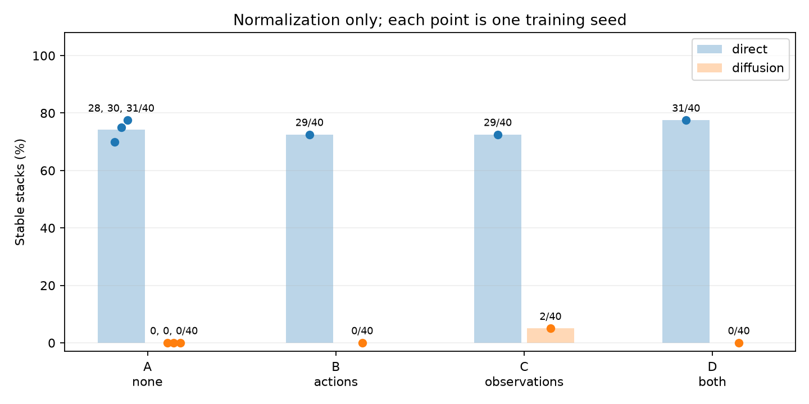
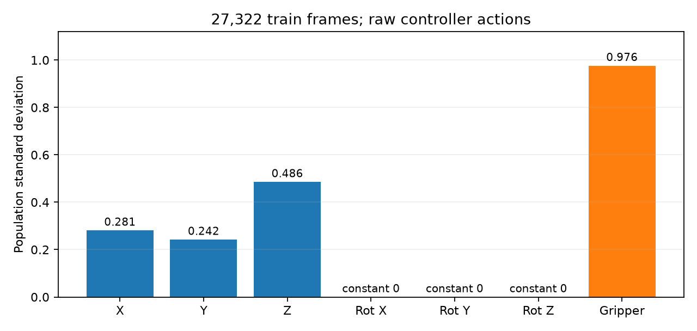

# Normalisierung: kontrollierter 2×2-Vergleich

A = keine Normalisierung (bestehende Läufe wiederverwendet), B = nur Actions, C = nur Observations, D = beides. Alle neuen Läufe beginnen mit frischer Initialisierung und haben ein festes Budget von 30.000 echten Optimizer-Updates. Die Tabellen enthalten ausschließlich vollständig trainierte und ausgewertete Läufe.

| Variante | Modell | Seed | Stabil /40 | Greifen | Lift | Transport | Position | Absenken | Release |
|---|---|---:|---:|---:|---:|---:|---:|---:|---:|
| A | direct | 1 | 28 | 37 | 37 | 37 | 37 | 36 | 30 |
| A | direct | 2 | 30 | 37 | 37 | 37 | 35 | 34 | 30 |
| A | direct | 3 | 31 | 35 | 34 | 34 | 34 | 34 | 31 |
| A | diffusion | 1 | 0 | 31 | 24 | 15 | 0 | 0 | 0 |
| A | diffusion | 2 | 0 | 26 | 18 | 8 | 0 | 0 | 0 |
| A | diffusion | 3 | 0 | 27 | 19 | 9 | 2 | 0 | 0 |
| B | direct | 1 | 29 | 38 | 38 | 37 | 37 | 36 | 30 |
| B | diffusion | 1 | 0 | 30 | 22 | 10 | 1 | 0 | 0 |
| C | direct | 1 | 29 | 39 | 38 | 38 | 37 | 37 | 32 |
| C | diffusion | 1 | 2 | 27 | 24 | 24 | 12 | 5 | 3 |
| D | direct | 1 | 31 | 39 | 35 | 35 | 33 | 33 | 31 |
| D | diffusion | 1 | 0 | 27 | 25 | 25 | 7 | 3 | 0 |

## Offline-Diagnosen und Aufwand

XY/Expert und Grenzreaktion: Median; Cosinus: Mittelwert. Alle Actions vor Messung zurück in ursprüngliche Controller-Einheiten skaliert. Maximalhöhe: Median über 40 Rollouts; einzelne maximale Höhen in CSV/JSON.

| Variante/Modell/Seed | XY / Expert | Ziel-Cosinus | Expert-Cosinus | Grenzreaktion / Expert | Maximalhöhe m | Loss letzte 500 | Zeit min |
|---|---:|---:|---:|---:|---:|---:|---:|
| A/direct/1 | 76.01% | 0.9982 | 0.9977 | 1.65% | 1.0389 | 0.010800 | 10.6 |
| A/direct/2 | 81.46% | 0.9939 | 0.9944 | 1.97% | 1.0396 | 0.010709 | 10.6 |
| A/direct/3 | 77.59% | 0.9971 | 0.9977 | 1.71% | 1.0364 | 0.011354 | 10.9 |
| A/diffusion/1 | 28.68% | 0.5027 | 0.5064 | 0.62% | 0.9147 | 0.012741 | 17.6 |
| A/diffusion/2 | 25.80% | 0.4885 | 0.4920 | 0.43% | 0.8658 | 0.013591 | 50.9 |
| A/diffusion/3 | 25.36% | 0.4767 | 0.4812 | 0.58% | 0.8686 | 0.014351 | 37.3 |
| B/direct/1 | 79.85% | 0.9970 | 0.9975 | 1.56% | 1.0409 | 0.010967 | 12.0 |
| B/diffusion/1 | 28.54% | 0.5030 | 0.5067 | 0.60% | 0.8946 | 0.012684 | 37.7 |
| C/direct/1 | 95.59% | 0.9957 | 0.9961 | 7.60% | 1.0479 | 0.005224 | 7.3 |
| C/diffusion/1 | 74.49% | 0.9287 | 0.9314 | 1.42% | 1.0253 | 0.010413 | 36.0 |
| D/direct/1 | 96.28% | 0.9955 | 0.9962 | 8.68% | 1.0492 | 0.005203 | 15.8 |
| D/diffusion/1 | 72.87% | 0.9287 | 0.9315 | 1.35% | 1.0272 | 0.010318 | 88.1 |

## Unveränderte Kontrollen

Identische 180/20 Demonstrationen, zwei Beobachtungsframes mit 15 Kanälen, 16×7 Action-Chunks, ausgeführt werden Chunkpositionen 1 und 2. Batch 8, uniforme historische Sampler je Modellklasse, AdamW 1e−4 / Weight Decay 1e−6, 500 Warmup-Updates, Cosine über 30.000 Updates, EMA-Power 0,75. Direct: ursprünglicher Residual-MLP mit Tanh und Chunk-MSE. Diffusion: ursprünglicher UNet, Epsilon-MSE, DDIM mit zehn Schritten und unverändertem Clip-Sample. Keine zusätzlichen Merkmale, Loss-Gewichte, Heuristiken, Datenänderungen oder Zwischencheckpoint-Auswahl.

Präzisierung der historischen Sampling-Beschreibung aus dem installierten Quellcode: Direct verwendet numpy.default_rng mit Zurücklegen. Beim einzelnen Diffusion-Dataset liefert get_dataset_sampler() dagegen None; der bestehende DataLoader mischt ohne Zurücklegen innerhalb des jeweils neu gestarteten Epoch-Iterators, von dem 100 Batches genutzt werden. Diese tatsächlichen historischen Verfahren bleiben jeweils erhalten. Für neue Diffusion-Läufe werden die tatsächlich konsumierten Indexfolgen gespeichert; die neuen Normalisierungszellen sind bei gleichem Seed gepaart. Historische Diffusion-Batchindizes sind nicht verfügbar.

40 Startseeds 46000–46039; jeder Simulator-Startzustand muss denselben SHA-256 wie in der Baseline haben. Phasenindikatoren bleiben exakt unverändert und sind separat gezählte Diagnosen. Stabiler Stack verlangt Success in 40 zusätzlichen Frames, Kontakt und keinen Grasp. Greifen: natives Prädikat; Lift B-z>0,88 m; Transport: gehalten, B-z>0,98 m, XY-Geschwindigkeit>0,02 m/s und Ziel-Cosinus>0,5 für drei Frames. Position: XY<9 mm bei B−A-z>3,2 cm; Absenken zusätzlich B−A-z=4 cm ±8 mm; Release zusätzlich Kontakt und kein Grasp.

Offline: dieselben 20 Validierungsdemos, −10 bis +10 Frames am Expert-Umschaltpunkt; Aktion an Chunkposition 1. Diffusion: dieselben acht Initialrausch-Samples je Beobachtung, 32 gepaarte Samples je Grenzpaar −1/0. XY/Expert und Cosinus werden im Transportfenster +6 bis +10 gemessen. Grenzreaktion = Norm des vorhergesagten XYZ-Sprungs / Norm des Expert-Sprungs.

Alle neuen Losses pro Update werden exportiert. Direct-MSE ist bei Action-Normalisierung in transformierten Einheiten; Diffusion-Loss misst Epsilon und ist nicht unmittelbar mit Direct-Loss vergleichbar. A/Diffusion hat historisch nur Epochmittelwerte; A/Diffusion/1-Zeit ist die Summe der Trainingsepochen und schließt Checkpoint-I/O sowie Validierung aus. Andere Zeiten sind Laufzeiten mit den im JSON benannten Grenzen.

Normalisierungsstatistiken werden ausschließlich auf den 27.322 ungepaddeten Trainingsframes angepasst. Dieselben Werte gelten für beide Historyslots, alle Chunkpositionen, Validierung und Rollout. Im nativen Dataset wird auch der Validierungs-Action-Cache mit den Trainingsstatistiken aufgebaut.

## Kanalstatistiken und Transformation

Observations: (x−Mean)/(Population-Std+0,001), ohne Clipping. Actions: native Robomimic-Min-Max-Abbildung auf ±0,999999. Bei Spannweite<0,0001: Scale=1 und Offset=Minimum, damit konstante Kanäle keine Division durch null verursachen. Inverse Actions: raw=normalized×Scale+Offset. Tanh und DDIM-Clipping bleiben erhalten.

| Typ/Schlüssel/Kanal | Min | Max | Mean | Std |
|---|---:|---:|---:|---:|
| observation/robot0_eef_pos/0 | -0.1431637 | 0.1328918 | -0.01351001 | 0.07418014 |
| observation/robot0_eef_pos/1 | -0.1383083 | 0.1349287 | -0.003948544 | 0.07410716 |
| observation/robot0_eef_pos/2 | 0.8213676 | 1.057879 | 0.9222656 | 0.07904854 |
| observation/robot0_eef_quat/0 | 0.9683564 | 0.9996814 | 0.9956036 | 0.0033578 |
| observation/robot0_eef_quat/1 | -0.05614213 | 0.07993694 | 0.001588097 | 0.02112309 |
| observation/robot0_eef_quat/2 | -0.0144371 | 0.2451067 | 0.08571877 | 0.03014367 |
| observation/robot0_eef_quat/3 | -0.03657369 | 0.03420373 | -0.0006579454 | 0.007525228 |
| observation/robot0_gripper_qpos/0 | 0.01818748 | 0.03999799 | 0.0256282 | 0.009091525 |
| observation/robot0_gripper_qpos/1 | -0.04000139 | -0.01777208 | -0.02564206 | 0.009109584 |
| observation/object/0 | -0.1264151 | 0.1311117 | -0.01191814 | 0.07466034 |
| observation/object/1 | -0.132475 | 0.1292429 | -0.007651787 | 0.07699496 |
| observation/object/2 | 0.8122236 | 0.83 | 0.8197205 | 0.001021047 |
| observation/object/3 | -0.1399584 | 0.1362992 | -0.006004921 | 0.0754844 |
| observation/object/4 | -0.1383976 | 0.1341268 | -0.004050028 | 0.07629602 |
| observation/object/5 | 0.8173446 | 1.055373 | 0.8909482 | 0.08381713 |
| action/actions/0 | -1 | 1 | 0.06885046 | 0.2809481 |
| action/actions/1 | -1 | 1 | -0.003803344 | 0.2421458 |
| action/actions/2 | -1 | 1 | -0.06458066 | 0.4856675 |
| action/actions/3 | 0 | 0 | 0 | 0 |
| action/actions/4 | 0 | 0 | 0 | 0 |
| action/actions/5 | 0 | 0 | 0 | 0 |
| action/actions/6 | -1 | 1 | 0.2163092 | 0.9763249 |

Actions sind [X,Y,Z,Rot-X,Rot-Y,Rot-Z,Gripper] in den ursprünglichen Controller-Einheiten. Translation und Gripper erreichen bereits ±1; die drei Rotationskanäle sind konstant null. Die Gripper-Std ist etwa 3,47× X-Std, 4,03× Y-Std und 2,01× Z-Std. Min-Max gleicht diese Varianzen hier praktisch nicht an: Scale≈1,000001 für X/Y/Z/Gripper, Scale=1 für Rotation, Offset=0. B ist somit ein nahezu identischer Action-Skalierungsarm. Eine Action-Z-Standardisierung wäre unter den unveränderten Tanh-/DDIM-Grenzen inkompatibel (Expert-Ziele außerhalb ±1) und wurde nicht gleichzeitig eingeführt.

## Interpretation

Deskriptive 2×2-Effekte für Trainingsseed 1 (Prozentpunkte; keine Signifikanztests):

| Modell | Observation-Effekt, über beide Action-Arme gemittelt | Action-Effekt, über beide Observation-Arme gemittelt | Interaktion D−C−B+A |
|---|---:|---:|---:|
| direct | +3.8 | +3.8 | +2.5 |
| diffusion | +2.5 | -2.5 | -5.0 |

Diffusion-Diagnosen für Seed 1: A: XY/Expert 28.7%, Ziel-Cosinus 0.503, Transport 15/40, Position 0/40, Release 0/40; B: XY/Expert 28.5%, Ziel-Cosinus 0.503, Transport 10/40, Position 1/40, Release 0/40; C: XY/Expert 74.5%, Ziel-Cosinus 0.929, Transport 24/40, Position 12/40, Release 3/40; D: XY/Expert 72.9%, Ziel-Cosinus 0.929, Transport 25/40, Position 7/40, Release 0/40. Verbesserungen dieser Teilindikatoren zeigen einen Einfluss auf die Steuerung; sie ersetzen den Nachweis stabiler Stacks über mehrere Trainingsseeds nicht.

Vor Auswertung der neuen Läufe wurde die Erweiterungsschwelle auf mindestens 8/40 stabile Diffusion-Stacks (20 Prozentpunkte über der Baseline) festgelegt. Jeder qualifizierte Arm wird für beide Modellklassen mit Seeds 2 und 3 wiederholt.

**Skalierungshypothese: offen; als hinreichende Erklärung des Stack-Versagens nicht unterstützt.** Diffusion Seed 1: B 0/40, C 2/40, D 0/40. Keine Variante erreicht die vorab festgelegte Schwelle von 8/40; daher keine zusätzlichen Seeds. Die fehlende native Normalisierung erklärt den ursprünglichen 0%-Befund anhand dieses Versuchs nicht überzeugend. Eine starke Hypothese, nach der Standard-Observation-Normalisierung allein das Versagen behebt, wird damit geschwächt. Eine andere Action-Varianzskalierung bleibt ungetestet, weil B nahezu identisch ist.

**Direct verändert sich ebenfalls:** A Seed 1 28/40; B 29/40; C 29/40; D 31/40. Bei nur einem Seed pro nicht repliziertem Arm beschreibt dieser Unterschied den beobachteten Lauf; er ist keine belastbare Schätzung des mittleren Effekts.

Replikate je Variante:

- A/direct: 28/40, 30/40, 31/40; Mittel 74.2%, Stichproben-SD 3.8 Prozentpunkte.
- A/diffusion: 0/40, 0/40, 0/40; Mittel 0.0%, Stichproben-SD 0.0 Prozentpunkte.

Die Trainingsseeds sind die unabhängigen Replikate. Die 40 gepaarten Starts und Offline-Rausch-Samples sind keine zusätzlichen Trainingsreplikate. Keine Signifikanzbehauptungen; insbesondere kleine Unterschiede zwischen C und D können bei nahezu identischer Action-Transformation durch empfindliche Optimierungsdynamik entstehen. Die Laufzeiten wurden auf dem vorhandenen Desktop erfasst; GPU-Auslastung durch andere Prozesse und Dateisystem-I/O waren nicht isoliert. Sie sind Aufwandsmessungen, keine kontrollierten Geschwindigkeitsvergleiche.

## Abbrüche

Keine dokumentierten Abbrüche. Jeder Update prüft endlichen Loss und Gradienten vor Optimizer.step; jeder Rollout prüft endliche Actions, ursprüngliche Controllergrenzen und korrekte Denormalisierung.

## Artefakte

- `results_normalization.json`: Einzelwerte der Rollouts, Offline-Frames, Grenzpaare und Onsets sowie Protokoll und Kanalstatistiken.
- `summary.csv`, `rollout_metrics.csv`, `offline_metrics.csv`, `boundary_metrics.csv`, `onset_metrics.csv`, `training_losses.csv`, `channel_statistics.csv`.
- Pro Lauf: unveränderte Modellkonfiguration plus Normalisierungsschalter, finaler Checkpoint, Initialisierungshash, Trainingsaudit, Offline-Chunks, Rollout-Zustände und Actions als NPZ, Zeit- und Verifikationsdateien.
- `verification.json` und `hashes.json`: Update-/Scheduler-/EMA-Zähler, Baseline-Vergleich, Daten-/Startzustandskontrollen, SHA-256. Finalcheckpoint bleibt erhalten; Intermediate- und doppelte Resume-Checkpoints werden nach Hashsicherung aus Platzgründen entfernt.
- `replication_decision.json`: vorab festgelegte Erweiterungsschwelle und qualifizierte Varianten.

Zusätzliche Nachweise: `channel_distributions.csv/json` enthält alle Roh- und transformierten Kanalstatistiken getrennt für Train/Valid; `environment_frozen.txt` hält die Paketversionen fest. Bei Abbrüchen bleiben vorhandene Teil-Losses und abgeschlossene Einzelrollouts separat erhalten und werden nicht als vollständige 40er-Auswertung interpretiert.

