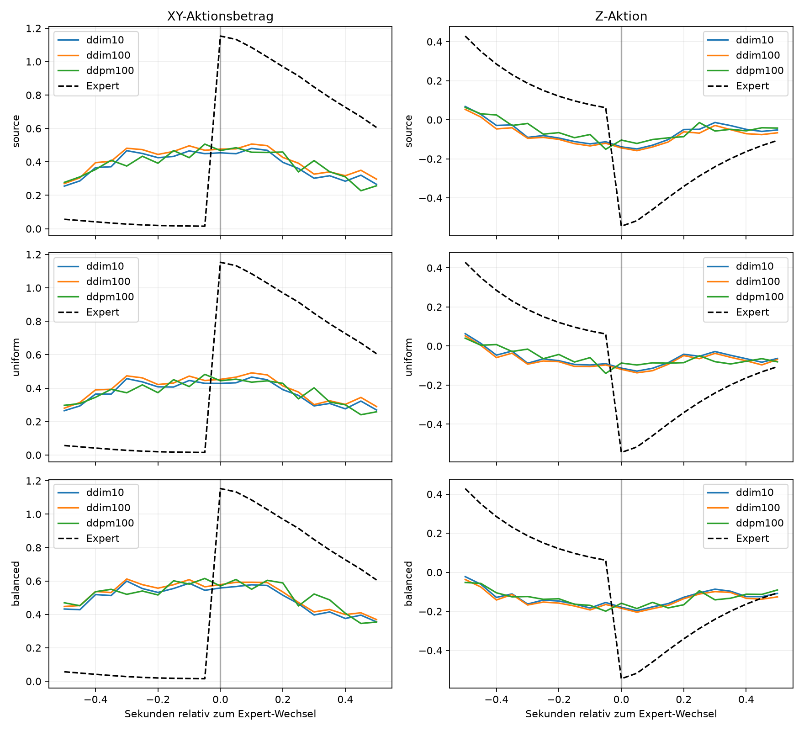
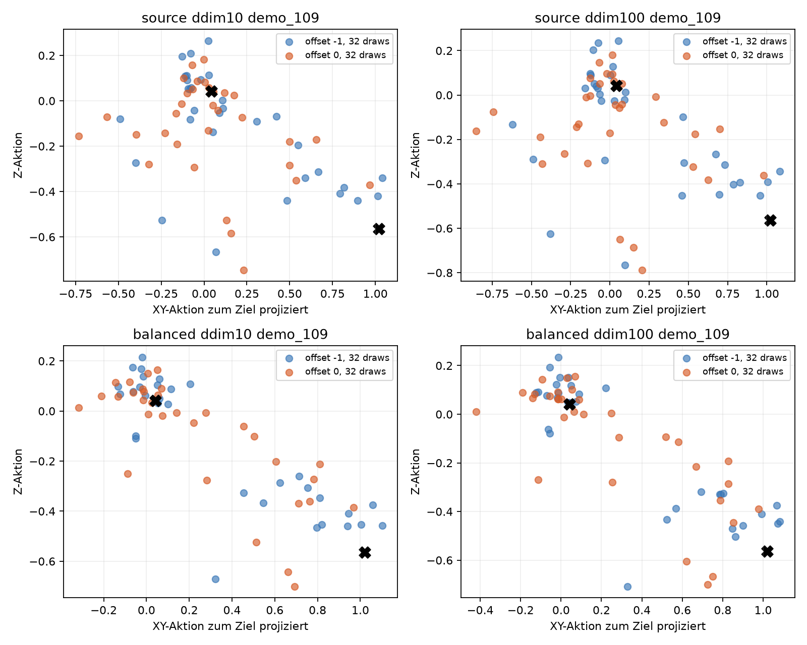

# Diagnose der zeitlich falschen Lift→Transport-Umschaltung

## Ergebnis

**Am stärksten gestützt: C – unzureichende Zustandskonditionierung der gelernten Diffusionsvorhersage; E – ungünstige Repräsentation der kleinen Umschaltmerkmale ist eine plausible Teilursache.** Die Policy produziert für einen gegebenen Zustand eine Mischung aus Lift-, Transport- und Zwischenaktionen. Der kleine reale Beobachtungswechsel ändert diese Verteilung kaum; initiales Diffusionsrauschen entscheidet wesentlich stärker über den Modus. Balancierung verschiebt die Modusgewichte zugunsten des Transports, ohne die zustandsabhängige Grenze sauber zu lernen.

A ist lokal plausibel, aber ein grundsätzlicher Mangel an zeitlicher Information ist nicht belegt: aus Höhen und Vertikalgeschwindigkeiten, die bereits in den zwei Frames enthalten sind, lassen sich die kritischen Grenzframes auf Validierung zu 95 % unterscheiden. B beschreibt eine Mischung beim Zusammenfassen unterschiedlicher Phasen, keine belegte widersprüchliche Expert-Verteilung bei exakt identischen Inputs. D beeinflusst Streuung und einzelne Modusziehungen, löst die fehlerhafte Konditionierung aber mit keiner getesteten Inferenzkonfiguration.

Keine neuen Gewichte, kein Training, kein Oversampling, keine Architekturänderung, kein XY-Regler. Die Untersuchung bleibt offline; neue Sampler-Rollouts wurden nicht durchgeführt.

## Beobachtungen und lokaler Informationsgehalt

Alle 200 Demos: Fenster ±10 Frames = ±0,5 s um den bereits definierten Expert-Umschaltpunkt. Training-/Validierungssplit 180/20 unverändert. Policy-Input: zwei Frames mit EEF-Position, EEF-Quaternion, Fingerpositionen und A/B-Positionen (15 Merkmale pro Frame). Keine expliziten Geschwindigkeiten, relative Zielvektoren oder Expert-Phase. Relativpositionen und Geschwindigkeiten sind aus den vorhandenen Werten berechenbar.

| Letzter Lift → erster Transport | Median |
|---|---:|
| Änderung EEF-Höhe | 0.966 mm |
| Änderung B-Höhe | 0.965 mm |
| Physischer Abstand beider 2-Frame-Histories | 2.303 mm |
| Fingeränderung | 0.000866 mm |
| Änderung relativer B→Ziel-XY-Vektor | 0.175 mm |
| EEF-Orientierungsänderung | 0.034 Grad |
| Expert-XY-Aktionssprung | 1.170 |
| Expert-Z-Aktionssprung | -0.607 |

Der physische History-Abstand ist die Frobeniusnorm über beide Frames und Positionen/Finger, ohne Quaterniondimensionen. Er ist eine Näheangabe, kein Beweis gleicher Information. Aktionen sind normierte Controllerkommandos, keine Meter.

Im klaren Lift liegt die mediane EEF-Vertikalgeschwindigkeit bei 0.251 m/s und die EEF-Änderung zwischen Frames bei 12.56 mm. Am letzten Liftframe: 0.024 m/s, am ersten Transportframe: 0.019 m/s. Beide Grenzhistories zeigen zunächst noch Aufwärtsbewegung; die nachfolgende Richtungsumkehr ist am ersten Transportframe noch nicht beobachtet. Die starke Verzögerung und absolute Höhe liefern dennoch Hinweise auf das Ende des Lifts.

### Trennbarkeitsprobe ohne Policy-Training

1-Nächster-Nachbar: Referenz nur 180 Trainingsdemos, Test auf allen 20 Validierungsdemos. Merkmale mit Mittelwert/Standardabweichung der Trainingsfenster skaliert; keine neue Policy oder neuronale Architektur trainiert. Die Probe misst erreichbare Unterscheidbarkeit auf Expert-Daten, keine Rollout-Robustheit und keinen Optimalitätsbeweis.

| Merkmale aus vorhandenem Input | Ganzes ±0,5-s-Fenster | Nur k−1 / k |
|---|---:|---:|
| Ein Frame, alle 15 Merkmale | 77.1% | 62.5% |
| Zwei Frames, alle 30 Merkmale | 83.8% | 70.0% |
| Abgeleitete relative Geometrie und Geschwindigkeiten | 96.7% | 72.5% |
| EEF-/B-Höhe | 83.8% | 92.5% |
| EEF-/B-Höhe und beide Vertikalgeschwindigkeiten | 99.5% | 95.0% |

Eine ausschließlich auf Train-Grenzframes gewählte EEF-Höhenschwelle (1.054342 m) erreicht auf den 40 Validierungs-Grenzframes 87.5%. Dies ist eine Diagnose, keine in die Policy eingebaute Regel.

Unter 4200 untersuchten 30D-Histories: 0 exakt doppelte Inputs, 0 exakt gleiche Inputs mit widersprüchlicher Aktion. Das schließt ungeprüfte Zustände oder praktische Mehrdeutigkeit bei Mess-/Rolloutabweichungen nicht aus.

Der Expert hält intern Phase, Phasenschritte und ein beim Phasenbeginn fixiertes Ziel. Im Lift wechselt er nach Erreichen des gespeicherten Ziels und Mindestdauer; erst die nächste Aktion verwendet das Transportziel. Diese Variablen stehen nicht explizit im Input. Dadurch ist strukturelle partielle Beobachtbarkeit möglich, aber die realen Demos liefern gute physische Ersatzhinweise. Kleine geometrische Nähe darf hier nicht automatisch als unvermeidbares Observation Aliasing interpretiert werden.

## Expert-Aktionsverteilung

Klarer Lift: k−20…k−11; unmittelbar davor k−3…k−1; danach k…k+2; stabiler Transport k+6…k+10, jeweils mit passender rekonstruierter Expert-Phase.

| Bereich | Frames | XY-Norm, Median | Z, Median | XY / abs(Z), Median | Öffnen |
|---|---:|---:|---:|---:|---:|
| Klarer Lift | 2000 | 0.071 | +1.000 | 0.09 | 0.0% |
| Vor Umschaltung | 600 | 0.012 | +0.076 | 0.14 | 0.0% |
| Nach Umschaltung | 600 | 1.128 | -0.517 | 2.25 | 0.0% |
| Stabiler Transport | 1000 | 0.701 | -0.147 | 4.08 | 0.0% |

Beim Wechsel springt die Aktion von schwachem vertikalem Rest-Lift zu starkem XY-Transport und gleichzeitigem Absenken. Der Transport-Expert bewegt sich nicht rein horizontal: sein Ziel liegt tiefer als die angehobene Ausgangshöhe. Zusammengefasste Vor-/Nach-Samples erzeugen daher klar getrennte Aktionsbereiche. Die Aktionsrichtungen in absoluten XY-Koordinaten variieren zudem mit dem jeweiligen Zielvektor.

Zielrichtung: medianer Cosinus zur EEF→A-Richtung nach Umschaltung 0.998, im stabilen Transport 1.000. Die kleinen Lift-XY-Korrekturen halten dagegen die ursprüngliche Griff-/Liftposition und müssen noch nicht zum Zielwürfel zeigen. Ihre oft negative Zielausrichtung ist kein Expert-Transportfehler.

Die vorhandene Expert-Implementierung reproduziert alle gespeicherten Aktionen mit maximalem Fehler 3e-08. Es gibt keine Evidenz für mehrere Demonstratorstile oder zufällige Freigaben am Wechsel. Eine abrupte deterministische Umschaltung ist von mehreren gleichwertigen Aktionen bei exakt gleicher vollständiger Information zu unterscheiden.

## Mehrfachsamples und isolierte Samplervergleiche

Dieselben 420 Expert-Observations (20 Validierungsdemos × 21 Offsets); 8 Seeds pro Observation, 32 Seeds an k−1 und k. Insgesamt 4.320 gespeicherte vollständige 16×7-Chunks je Modell/Sampler. 220 Observation-Histories sind bitgenau mit den zuvor gespeicherten Offline-Observations abgeglichen; übrige Zwischenframes stammen unverändert aus demselben HDF5. Alle drei eingefrorenen Modelle werden untersucht.

Bestehende Diffusers-Klassen: DDIM 10/20/50/100 Schritte mit eta=0, DDIM 10/100 mit eta=1 und vorhandener DDPM mit 100 Schritten. Trainings-Betas, epsilon-Parametrisierung und Clipping identisch; keine neue Samplingmethode implementiert. Der instrumentierte DDIM-10-Loop liefert bei identischem GPU-Rauschen in allen drei Modellen exakt dieselben Aktionen wie die native Methode (maximaler Fehler 0).

Eta=0 ist nur bei festem Ausgangsrauschen deterministisch. Die bisherige Policy zieht bei jedem Replanning neues Gaußrauschen und ist damit trotz eta=0 stochastisch. Eta=1 fügt zusätzlich Rauschen in den vorhandenen Scheduler-Schritten hinzu.

Modusdefinition für erste ausgeführte Aktion (Chunkindex 1): Lift = XY<0,12, Z>0,02, Gripper geschlossen; Transport = XY>0,25, Zielcosinus>0,5, Z<−0,05, Gripper geschlossen. Beide Kriterien lassen Misch-/Fehlaktionen bewusst unklassifiziert. Vorbereich k−2,k−1; Nachbereich k…k+2.

| Modell / Sampler | Korrekter Lift davor | Transport danach | XY davor, Mittel | Z davor, Mittel | Transportbeginn ±0,1 s | Zu früh >0,1 s |
|---|---:|---:|---:|---:|---:|---:|
| source / ddim10 | 25.3% | 47.9% | 0.458 | -0.118 | 25.0% | 45.0% |
| source / ddim20 | 25.9% | 48.1% | 0.474 | -0.124 | 23.1% | 46.2% |
| source / ddim50 | 25.9% | 47.1% | 0.486 | -0.128 | 21.9% | 48.1% |
| source / ddim100 | 25.0% | 45.8% | 0.483 | -0.127 | 20.6% | 42.5% |
| source / ddim10_eta1 | 28.4% | 50.8% | 0.424 | -0.107 | 17.5% | 43.1% |
| source / ddim100_eta1 | 32.5% | 46.7% | 0.503 | -0.134 | 16.9% | 44.4% |
| source / ddpm100 | 35.6% | 44.4% | 0.466 | -0.113 | 15.0% | 40.0% |
| uniform / ddim10 | 24.1% | 44.4% | 0.437 | -0.094 | 21.2% | 40.0% |
| uniform / ddim20 | 26.2% | 44.8% | 0.454 | -0.101 | 20.0% | 40.6% |
| uniform / ddim50 | 26.6% | 44.6% | 0.465 | -0.105 | 20.0% | 42.5% |
| uniform / ddim100 | 25.3% | 44.4% | 0.459 | -0.101 | 20.0% | 41.9% |
| uniform / ddim10_eta1 | 27.5% | 48.8% | 0.403 | -0.086 | 17.5% | 42.5% |
| uniform / ddim100_eta1 | 33.8% | 44.8% | 0.469 | -0.112 | 15.6% | 43.8% |
| uniform / ddpm100 | 35.9% | 41.7% | 0.446 | -0.100 | 16.2% | 40.6% |
| balanced / ddim10 | 21.2% | 57.9% | 0.565 | -0.169 | 15.6% | 71.9% |
| balanced / ddim20 | 21.6% | 58.1% | 0.583 | -0.177 | 15.0% | 71.2% |
| balanced / ddim50 | 22.5% | 59.0% | 0.596 | -0.184 | 16.2% | 71.2% |
| balanced / ddim100 | 23.1% | 58.8% | 0.587 | -0.179 | 16.2% | 71.2% |
| balanced / ddim10_eta1 | 23.1% | 65.4% | 0.562 | -0.180 | 12.5% | 75.0% |
| balanced / ddim100_eta1 | 25.9% | 58.8% | 0.623 | -0.200 | 13.8% | 69.4% |
| balanced / ddpm100 | 28.4% | 56.7% | 0.598 | -0.184 | 16.2% | 62.5% |

Zeitpunkt: erster Run von drei XY-Aktionen >0,25 mit Zielcosinus >0,5 über den Expert-Observation-Sweep. Ein Beginn bei k−10 ist links zensiert. Acht Zufallsziehungen pro Demo; diese offline Zeitpunkte sind keine zusätzlichen Simulator-Rollouts. Andere Seeds und erste statt beide Chunk-Aktionen erklären kleinere Abweichungen gegenüber dem vorigen Bericht.

| DDIM10: Streuung bei identischer Grenzbeobachtung | Source | Uniform | Balanciert |
|---|---:|---:|---:|
| XY-Norm-Standardabweichung, Mittel | 0.376 | 0.369 | 0.399 |
| Z-Standardabweichung, Mittel | 0.222 | 0.234 | 0.230 |
| Grenz-Observations mit beiden Modi | 95.0% | 95.0% | 85.0% |

„Beide Modi“ = je mindestens 15 % Lift- und Transportziehungen unter 32 Samples derselben Observation. Das belegt Koexistenz unterschiedlicher Modi; es ist kein formaler Dichte-/Dip-Test auf genau zwei Gipfel für jeden Zustand. Die Punktwolken enthalten zusätzlich Zwischenaktionen und falsch gerichtete XY-Kommandos.

### Derselbe Seed vor und nach dem Wechsel

Zusätzlich 32 identische Ausgangsrausch-Chunks für beide Grenzbeobachtungen jedes Validierungsdemos, jeweils DDIM10/100. So wird ausschließlich die Beobachtung geändert.

| Modell / Sampler | Policy-XYZ-Sprung / Expert-Sprung, Median |
|---|---:|
| source / paired_ddim10 | 0.62% |
| source / paired_ddim100 | 0.56% |
| uniform / paired_ddim10 | 0.50% |
| uniform / paired_ddim100 | 0.46% |
| balanced / paired_ddim10 | 0.40% |
| balanced / paired_ddim100 | 0.40% |

Die Verteilung reagiert kaum auf die reale Umschaltänderung, obwohl derselbe Zustand über Seeds viel größere Schwankungen erzeugt. Der Effekt bleibt mit 100 Schritten bestehen. Das spricht gegen einen alleinigen Integrationsfehler von DDIM10 und für eine fehlende scharfe Abhängigkeit des gelernten Denoisers von den relevanten Zustandsmerkmalen.

## Direkter Denoiser-Test und Zwischenschritte

Gespeichert sind vollständige Action-Chunks und für repräsentative Zustände die Action-, epsilon- und x0-Vorhersagen jedes Denoising-Schritts. Außerdem werden echte Expert-Chunks einmal vorwärts verrauscht und das gelernte epsilon-Netz direkt ausgewertet: x0=(x_t−sqrt(1−alpha_bar)*epsilon_pred)/sqrt(alpha_bar), mit bisherigem Clipping. Dies testet den Denoiser ohne lange DDIM-Rückwärtskette.

| Source, Rauschzeit t | Lift davor rekonstruiert | Transport danach rekonstruiert | XYZ-MAE |
|---|---:|---:|---:|
| 0 | 100.0% | 100.0% | 0.011 |
| 10 | 67.5% | 100.0% | 0.045 |
| 30 | 15.0% | 98.3% | 0.117 |
| 50 | 2.5% | 95.0% | 0.205 |
| 70 | 0.0% | 81.7% | 0.260 |
| 90 | 0.0% | 55.0% | 0.294 |
| 99 | 0.0% | 43.3% | 0.879 |

Bei wenig Rauschen steckt die korrekte Aktion bereits im Input; hohe Rekonstruktionsgenauigkeit dort beweist keine richtige Zustandskonditionierung. Schon bei mittlerem Rauschen verliert der Denoiser besonders den Liftmodus. Bei t=99 verstärkt sehr kleines alpha_bar epsilon-Fehler enorm; niedriger epsilon-MSE ist daher kein Nachweis brauchbarer x0-/Aktionsvorhersagen. Dieser Probe liegt eine Korruption pro Expert-Observation zugrunde, nicht eine neue Trainingsrunde.

Im gepaarten Test am ersten DDIM10-Schritt (t=90) erhält das epsilon-Netz exakt dasselbe verrauschte Action-Array für Vor-/Nachbeobachtung. Seine beobachtungsbedingte epsilon-Änderung beträgt im Median nur etwa 0,3–0,4 % der für zwei exakte deterministische Expert-Aktionen benötigten Änderung. Das ist zusätzliche Evidenz direkt aus dem Modelloutput. Bei t=99 ist dieser Vergleich wegen winziger alpha_bar und Clipping erheblich empfindlicher; dort wird keine gleichermaßen starke Einzelinterpretation behauptet.

## A–E: Evidenz und Gegenargumente

| Hypothese | Evidenz | Gegenargument / Grenze | Einordnung |
|---|---|---|---|
| A: Aliasing / fehlender Kontext | Verborgene Expert-Phase und fixiertes Ziel; Grenzstates nur rund 1 mm auseinander; erste Transporthistory zeigt noch Aufwärtsbewegung | Höhen + aus zwei Frames abgeleitete Geschwindigkeiten trennen 95 % der Grenzframes; keine exakten widersprüchlichen Inputs gefunden | Lokale Empfindlichkeit plausibel; notwendige längere History nicht belegt |
| B: Multimodale Demonstrationen | Gepoolte Vor-/Nach-Phasen haben weit auseinanderliegende XY/Z-Aktionen; verschiedene absolute XY-Richtungen | Deterministischer Expert reproduziert die Daten; Modes gehören überwiegend zu unterschiedlichen, unterscheidbaren States | Abrupte Verteilung ja; echte Mehrdeutigkeit je exaktem Input nicht belegt |
| C: Diffusion-Modellierung | Seed-dominiertes Lift/Transport-Gemisch, kaum Reaktion auf gepaarte Grenzobservations; Denoiser verliert Lift bei mittlerem Rauschen; alle Sampler behalten breite Fehlumschaltung | Kein Vergleich mit anderer Policyfamilie; Diffusionsmodell, Konditionierung, Verlustgewichtung und Repräsentation nicht vollständig getrennt | Am stärksten gestützt: gelernte lokale Konditionierung unzureichend |
| D: DDIM-Inferenz | Seeds ändern Modus; eta und Sampler beeinflussen Wahrscheinlichkeiten und Varianz | DDIM100 und DDPM100 lernen keine bessere Umschaltgrenze; gleicher Noise führt weiter zu fast identischen Nachbarvorhersagen | Sekundärer Einfluss, keine belegte primäre Samplerursache |
| E: Repräsentation / Merkmalsmaßstab | Modell bekommt rohe absolute State-Histories ohne explizite Δ-/Velocity-/Phasenmerkmale; physisch kleine Umschaltänderung; selektive Cue-Repräsentation trennt viel besser als voller Raw-Space | Trennbarkeitsprobe ändert Merkmalsgewichtung; kein kontrollierter neu trainierter Repräsentationsvergleich | Plausibler konkreter Mechanismus innerhalb C, noch keine kausale Bestätigung |

## Sinnvollster nächster Forschungsversuch

Zuerst die vorhandene Information gezielter repräsentieren: explizite, sinnvoll skalierte Höhen-/Delta-/Vertikalgeschwindigkeitsmerkmale aus denselben zwei Frames in einem kontrollierten Trainingsvergleich. Dies fügt keine neue zeitliche Information hinzu und testet, ob die Policy den bereits beobachtbaren Phasenhinweis besser nutzt. Gewichte und sonstiges Verfahren müssten dabei kontrolliert werden. Eine explizite Expert-Phase wäre anschließend eine informative Oracle-Gegenprobe, aber keine ungeprüfte deploybare Lösung.

Mehr History ist durch diese Daten weniger direkt begründet als bessere Nutzung der vorhandenen History. Ein anderer Sampler ist als erste Trainings-/Forschungsmaßnahme ebenfalls nicht durch die Inferenzvergleiche gestützt. Eine andere Policy-Struktur sollte erst nach dieser Eingrenzung getestet werden. Hier wurde keiner dieser Trainingsversuche begonnen.

## Reproduzierbarkeit und Grenzen

Ein Datensatz, drei eingefrorene Checkpoints, 20 feste Validierungsdemos, 8/32 Diffusionsziehungen; keine neuen Rollout-Erfolgsraten. Observer-Trennbarkeit gilt für Expert-States und kann im geschlossenen Regelkreis wegen Greifoffsets, Heights und Sensor-/Controllerabweichungen schlechter sein. Nachbarschaftsproben liefern Evidenz gegen zwingende Informationsarmut, keine Garantie perfekter Markov-Beobachtbarkeit.

`panel.npz`/`panel.json`: exakte Histories und Expert-Chunks. Je Modell/Sampler NPZ: alle 16×7 Predictions, Panelindices und Seeds, repräsentative Denoisingpfade und epsilon-/x0-Ausgaben. `paired_*.npz`: identische Latents beider Grenzstates. `forward_denoiser.npz`: direkter Modelltest. Scheduler-JSONs speichern sämtliche tatsächlichen Samplerparameter; Native-Parität ist gesondert geprüft. Die originalen Checkpoints und HDF5-Daten bleiben unverändert, einschließlich 62 Demos mit schwarzen Bildern; RGB wird hier nicht gelesen.

[Protokoll](protocol.json), [Datenanalyse](data_analysis.json), [Sampler-Metriken](sampling_analysis.json), [Gepaarte Sensitivität](paired_analysis.json).
